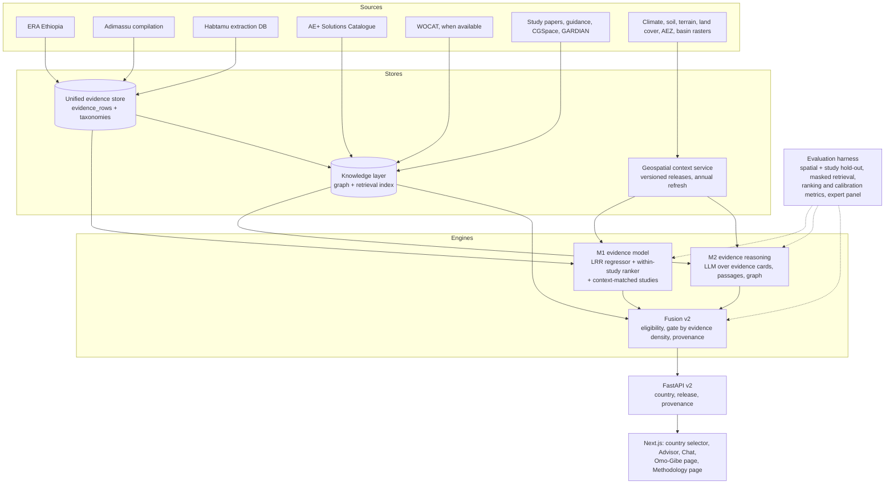

# AE+ Transform: enhancement roadmap

**Version 1.0, 10 November 2026. Author: Senior AI Engineer. Owner: Misganu Tuse, Alliance of Bioversity International and CIAT.**
**Status: proposal for owner and team review. Once approved it replaces the "Immediate next actions" of `progress.md` and becomes the phase plan Claude Code implements, one phase at a time.**

This document turns the team discussion of 9 November 2026 into a defensible methodology and an implementation plan for the next generation of AE+ Transform: an evidence-fusion advisor that ranks agroecological practices for one location, built for Ethiopia first and designed from the start to be replicated country by country.

---

## 0. How to read this document

Sections 1 and 2 state where the system is and what the team decided to change. Section 3 fixes the principles every later choice must respect. Sections 4 to 12 are the design: data, geospatial context, the recommendation problem, the two methodologies and their hybrid, the evaluation protocol that decides between them, the Omo-Gibe layer and the product changes. Section 13 is the phased work plan with acceptance criteria. Sections 14 to 16 list engineering standards, risks and open decisions. Appendices hold the schemas and metric definitions that the implementation must follow exactly.

Vocabulary used throughout:

| Term | Meaning in this document |
|---|---|
| Context | The vector of geospatial attributes read for one location (rainfall, temperature, slope, soils, land cover, agro-ecological belt, and the new layers of section 6). |
| Challenge | The problem a land user faces (soil erosion, moisture stress, low soil fertility, feed shortage, ...). Decided on 10 November: problem-based and derived from the data (section 5.4). |
| Objective | The measurable outcome the user wants to improve within a challenge (yield, soil loss, runoff, soil organic matter, income, ...). |
| Practice | One agroecological solution (stone bund, tied ridging, push-pull, ...), identified by a canonical id in the practice taxonomy. |
| Evidence row | One with/without comparison from a field study: practice versus comparator, one outcome, one site, one period, with the means and dispersion reported. |
| Log response ratio (LRR) | `ln(mean_with / mean_without)`, the effect size used across ERA and this project. |
| M1, M2, M3 | Methodology 1 (evidence model plus RAG), Methodology 2 (LLM evidence reasoning without a trained model), Methodology 3 (the hybrid, section 10). |

---

## 1. Where the system is today (baseline, verified 10 November 2026)

| Component | State |
|---|---|
| Evidence dataset | `data/processed/CSA_ERA_final_model_ready.csv`: 8,664 with/without rows (ERA Ethiopia 7,250; Adimassu et al. compilation 1,414), 337 studies, 100 practice labels in 5 practice families, 7 outcome indicators, 12 of 15 belts represented. Rows carry coordinates and the 11 raster features. |
| Geospatial context | 11-layer 250 m Ethiopia stack (`geodata/layers/`, 730 MB, git-ignored): belt, rainfall, temperature, seasonality, growing period, elevation, slope, clay, pH, SOC, land cover. Downloaders exist per layer (`pipelines/features/get_*.py`) but the stack is built once by hand and has no version or manifest. |
| Model | HistGBM on LRR, 13 features (7 categorical including `aez_belt` and `Indicator`, 6 numeric). Deterministic repeated grouped CV (10 x 5 folds grouped by study): R² 0.25 (baseline 0.19); ranking within (study, indicator) cells: top-1 hit 52% against 27.5% chance, top-half 77%, C-index 0.70, median Spearman 0.51, but only 68 comparable cells (584 pairs), which is thin for a headline. Confidence flags per indicator (yield and biomass medium, the rest low). |
| Retrieval | Tier 1: 306 DOI-linked study papers, 1,191 chunks. Tier 2: guidance documents (GARDIAN and others), 19,997 chunks. Chroma index, hybrid retriever, numeric guard v2. |
| Knowledge graph | NetworkX, 720 nodes and 1,961 edges: practices, components, families, studies, indicators, belts, crop groups, WOCAT vocabularies, `REPORTS_EFFECT` aggregates. WOCAT records themselves wait for the API agreement. |
| Doctrine | Evidence fusion (1 November 2026): the best evidence leads per practice (model-led, study-led, documented); every number has a source; the LLM phrases and cites, never produces a number. |
| Product | Next.js 16 trilingual UI (en, am, om), FastAPI backend, deployed for the Sodo validation at agroecoadvisor.duckdns.org. Workshop feedback sheet and deck delivered. |
| New data in hand | Habtamu Sewnet's extraction database (Grist): 1,617 rows, 47 columns, 605 study ids, 181 DOIs, 67 countries, 158 Ethiopian rows (14 DOIs); 1,312 rows allow an LRR, 646 also allow its variance; no coordinates. The Agroecology+ Solutions Catalogue (docx, 30 structured entries so far, soil and water conservation dominated). |
| Pending data | WOCAT (API agreement in preparation; proceed without it). Omo-Gibe hotspot/coldspot raster and typology raster (to be shared). Richer Omo-Gibe exercise data later. |

Two limits of the current design motivate most of what follows. First, the entry point is a practice family ("challenge" today) rather than the user's problem, so the system cannot say "you have gully erosion on a 20% slope, here is what works" without the user already knowing which family to open. Second, the model explains only a quarter of the variance in LRR because most of that variance is between studies (sites, seasons, management) rather than between practices; the product question, "which practice is better here", is a within-site comparison that the current regression answers only indirectly.

---

## 2. What the team decided to change (9 November) and how this roadmap frames it

| Team point | Design response | Section |
|---|---|---|
| 1. Start from all datasets and a sound methodology, production grade | One unified evidence store with a frozen schema and provenance, built by reproducible pipelines; everything versioned and tested. | 5, 14 |
| 2. More challenges and objectives, data-driven; add Habtamu's data and later WOCAT; Ethiopia first, then other countries, with a country selector | Problem-based challenge registry and outcome-based objective registry derived from the evidence store with explicit thresholds; a country configuration layer so Ethiopia is one instance of a general pipeline. | 5.4, 6.5, 12 |
| 3. Omo-Gibe Living Landscape menu with catalogue, hotspot/coldspot and typology rasters | Ethiopia-wide catalogue in the knowledge layer (decision 10 November); an Omo-Gibe overlay that adds basin rasters to the context and a landscape view. | 12.2 |
| 4. Geospatial context rebuilt from sources by script, rerun annually | A single refresh pipeline with a source manifest, versioned releases (`geodata/<country>/<release>/`), and a retrain hook; realistic update cadence per source. | 6 |
| 5. Belt is one attribute, not the organising level | Already one of 13 features in the model; the change is in candidate generation, evidence matching, explanation and copy, which no longer group by belt. Context similarity replaces belt membership. | 7, 8.4 |
| 6. Compare Methodology 1 and 2, keep the more accurate one, publish the comparison; add a Methodology page | A formal evaluation protocol with identical inputs, masked retrieval, spatial and study-grouped hold-out, ranking metrics, calibration and a human panel; M3 hybrid as the likely production design. | 8, 9, 10, 11, 12.4 |

On the remark "previously we grouped on study, now no need": grouping by study was never a modelling choice, it is the guard that stops rows of one trial sitting on both sides of a split. The new protocol keeps that guard and strengthens it with spatial blocks, because the product question is "a location we have never seen". What does change is how study structure is used in training: the new ranker learns from within-study practice contrasts (section 8.2), which is the positive use of the same structure.

---

## 3. Principles (unchanged doctrine plus three additions)

1. **Every number has a source, and the best evidence leads.** Unchanged (`docs/decisions/evidence_fusion.md`). The LLM phrases and cites. This also binds M2: an LLM-based advisor may rank and select, but every figure it shows is copied from an evidence card it cites.
2. **Cite or stay silent.** Unchanged.
3. **One evidence store, many sources.** New. ERA, the Adimassu compilation, Habtamu's database, the catalogue, WOCAT and future country datasets are loaded into one schema (Appendix A) with a `source` and a quality flag; no engine reads a raw file.
4. **Context is a vector, not a class.** New. Suitability and effect estimates are functions of the context vector. Classes (belt, Köppen, typology) are attributes shown to the user and available to the models, never the join key.
5. **Country is configuration.** New. Nothing in the pipelines, models or UI hard-codes Ethiopia; `countries/ET.yaml` does. Replicating to Kenya means a configuration file, a national AEZ product, national datasets and translations.
6. **Same inputs, same test, for every method.** New. A methodology is only compared on the protocol of section 11; no method sees the held-out studies through any channel (dataset, index, graph or prompt).
7. **Wrap, never fork; fail fast, degrade gracefully; schema names frozen.** Unchanged.

---

## 4. Target architecture



The engines are interchangeable behind one interface (`rank(context, challenge, objective, candidates, options) -> RankedList`). The evaluation harness drives the same interface, so the production comparison and the manuscript experiment are the same code.

---

## 5. Data layer: one evidence store

### 5.1 Unified evidence schema

All field evidence is loaded into `data/evidence/evidence_rows.parquet` (plus a CSV mirror for inspection) with the columns in Appendix A. Key design points:

- **Row = one with/without contrast**: practice (canonical id), comparator description, outcome (canonical id with direction), site, period, means, dispersion, sample sizes, and the derived `lrr`, `var_lrr` (when SD and N exist) and `weight`.
- **Provenance on every row**: `source` (ERA, CSA, HAB, WOCAT, ...), `study_id`, `doi`, `extraction_locator` (page or table), `evidence_text` (the sentence the number came from, when available). This is what the explanation layer cites.
- **Location**: `lat`, `lon`, `loc_precision` (exact, site, district, country), `loc_method` (reported, geocoded_llm_checked, geocoded_llm_unchecked, none). Context features are extracted from the raster release for rows with `loc_precision` of district or better; the rest keep their reported climate and altitude as `ctx_reported_*` fields.
- **Quality**: `quality_flag` from study design and replication (High, Medium, Low, NR) as reported by the source, never re-judged by an LLM.

### 5.2 Loading each source

| Source | Loader | Notes |
|---|---|---|
| ERA Ethiopia (7,250 rows) | `pipelines/evidence/load_era.py` | Re-derive from `data/raw/ERA_Ethiopia_dataset.csv` with the existing harmonisation rules (`docs/reports/`), keep `era_code`. |
| Adimassu compilation (1,414 rows) | `load_csa.py` | From `CSA_practices_by_Agroecology.xlsx`; references from `csa_study_references.json`. |
| Habtamu database (1,617 rows) | `load_habtamu.py` | Parse the text numerics (handles `NR`, ranges written as `700 to 900`, units); compute LRR for the 1,312 rows with both positive means and `var_lrr` for the 646 with SD and N; map `Outcome_name` and `Intervention_type` through the crosswalks of 5.3; geocode sites (5.5). The `.grist` file is kept as the archival original. |
| Catalogue (30+ entries) | `load_catalogue.py` | Not evidence rows: structured practice knowledge (category, suitable land use and belts, slope range, scale, problems addressed, benefits, evidence base, limitations, photos). Goes to the practice taxonomy and the knowledge graph (`Practice` attributes, `ADDRESSES_PROBLEM`, `SUITABLE_IN` edges) and to the retrieval index as Tier 2 documents. |
| WOCAT (later) | existing `rag/ingest/wocat` | Technology and approach records: suitability and compiler-rated impacts, under the API agreement (no redistribution). |

Each loader writes a data card (`data/evidence/cards/<source>.md`): rows in, rows dropped and why, coverage, licence.

### 5.3 Taxonomies and crosswalks

Three controlled vocabularies, each a CSV under `data/taxonomy/` with a review column, built the way `build_practice_family.py` was built: automatic proposal, human validation, frozen ids.

- **Practice taxonomy**: canonical practices with components (reusing `practice_components.py`), family, catalogue id, WOCAT SLM group and measure. The 100 frozen `CSA_practices` labels stay as aliases (data contract), the 458 Habtamu intervention labels and the catalogue names map onto canonical ids. Expected size: 120 to 160 canonical practices.
- **Outcome taxonomy**: canonical outcomes with direction and unit class, grouped into objective groups. The 7 current indicators remain; the 841 Habtamu outcome labels (and the catalogue benefit lists) map in. Groups expected: productivity (yield, biomass, fodder), soil health (SOC and SOM, fertility, structure), water (runoff, soil loss, moisture, water use efficiency), economics (income, cost, labour), resilience and biodiversity.
- **Problem taxonomy**: the challenge list (5.4).

Mapping method: deterministic rules first (normalised string match, component match), then an LLM proposal for the remainder with the candidate list constrained to the taxonomy, then a reviewer sheet. Nothing enters the frozen taxonomy without a human tick; the review sheets are kept for the manuscript.

### 5.4 Data-driven challenges and objectives

**Challenge registry** (`data/taxonomy/challenges.csv`): problem-based. Seed list from the catalogue's "key problems to be addressed" and from ERA and Habtamu outcome families: soil erosion (sheet and rill), gully erosion, soil fertility decline, soil moisture stress and drought, waterlogging and excess runoff, low crop productivity, feed shortage, pests and diseases, deforestation and fuelwood shortage, land degradation on hillsides, low income and market access. Each challenge links to: the objective groups that measure progress on it, the practice families and catalogue categories that address it, and the evidence count.

**Exposure rule**: a challenge or objective is shown in the UI for a country only when the evidence store holds at least `min_rows` rows (default 30) across at least `min_studies` studies (default 5) for that country, or when the knowledge layer holds at least `min_docs` documented practices for it (default 3). Below the thresholds the item exists but is marked "documented only" and is reachable through chat. The thresholds live in `countries/<cc>.yaml`.

**Multi-select** (Lule's point and the workshop sheet): a query can carry several challenges and objectives. Ranking uses the primary objective; the other objectives are reported per practice as co-benefits or trade-offs from the same evidence store (section 8.5).

### 5.5 Geocoding Habtamu's rows (decided 10 November: yes, with human check)

`pipelines/evidence/geocode_sites.py`: for each DOI, use the Tier 1 paper text when the paper is in the corpus (fetch open-access PDFs for the rest through the existing `fetch_papers.py`), ask the LLM for site names and any stated coordinates in a constrained JSON schema, resolve names with a gazetteer (GeoNames, offline copy for Ethiopia), assign `loc_precision`, and write `data/evidence/review/geocoding_review.csv` (one line per study: site, coordinates, confidence, the sentence). A reviewer (Habtamu or the owner) checks every Ethiopian study and a 20% sample of the rest; unchecked rows keep `loc_method = geocoded_llm_unchecked` and are excluded from training until checked.

---

## 6. Geospatial context v2: rebuilt from sources, versioned, refreshed on schedule

### 6.1 Pipeline

`pipelines/geodata/refresh.py --country ET --release 2026.1` does, in order: read `pipelines/geodata/sources.yaml`; download every source to a scratch cache (resumable, checksum-verified); warp each layer to the country grid defined by the national AEZ anchor (`countries/ET.yaml` points to the belt shapefile and the grid definition); run the QA checks (`final_qa.py` logic: nodata share, value ranges, alignment); write `geodata/ET/2026.1/` with the layers, `stack.vrt`, `manifest.json` (per layer: source, version, URL, download date, licence, checksum, resampling) and `qa_report.json`; print a diff against the previous release. The existing `get_*.py` scripts become modules of this pipeline (wrap, never fork).

The backend reads `GEODATA_RELEASE=ET/2026.1`; `extract_features.py` becomes the shared library for training and serving and records the release id into every feature vector. A release is immutable once published.

### 6.2 Refresh cadence per source (what "annual" means in practice)

| Layer | Source | Update behaviour | Cadence |
|---|---|---|---|
| Belt (AEZ) | national shapefile | static anchor | on national revision |
| Rainfall, temperature, seasonality, growing period | WorldClim 2.1 (1970 to 2000 normals) | static | re-verified each release |
| Recent climate normals (new) | CHIRPS v2 and ERA5-Land or TerraClimate, rolling 20 to 30 year window | changes each year | annual |
| Elevation, slope, and the new terrain layers | Copernicus GLO-30 | static | re-verified |
| Clay, pH, SOC (and new depth, sand, bulk density) | SoilGrids v2 | occasional | re-verified |
| Land cover | ESA WorldCover 2021 now; add the annual product (Dynamic World or WorldCover successor) | annual | annual |
| Vegetation and degradation trend (new) | MODIS or Landsat NDVI trend | annual | annual |
| Access (new) | travel time to markets and towns | occasional | re-verified |

The annual run therefore changes the layers that actually change (land cover, recent climate, vegetation trend) and proves the rest unchanged by checksum. The retrain hook (`model/train_model.py --release ET/2026.1`) re-extracts training features from the new release so model and serving never read different stacks.

### 6.3 New layers (why each one earns its place)

The feedback sheet and the catalogue both say that what decides a practice is position on the slope, drainage, soil depth and access, not the belt. Candidate additions, each with a one-line test for keeping it (improves grouped ranking metrics or is needed for eligibility rules):

- Terrain: slope length and steepness factor, topographic position index, topographic wetness index, flow accumulation and distance to drainage lines (gully and check-dam eligibility, waterlogging).
- Soil: depth to bedrock, sand, bulk density, available water capacity (bund and terrace suitability, moisture stress).
- Climate: aridity index and dry-season length from the recent normals (drought challenge).
- Land: NDVI trend as a degradation proxy; cropland fraction.
- Access: travel time to the nearest market town (income objective, input availability).

The belt stays as one attribute. The Köppen class and the Omo-Gibe typology class are attributes too.

### 6.4 Resolution

250 m stays for the national stack (the evidence has site precision, not field precision). Omo-Gibe rasters are used at their native resolution and read at the pin.

### 6.5 Country configuration

`countries/ET.yaml`: country code, bounding box and grid, AEZ anchor and lookup, languages, evidence sources enabled, exposure thresholds, Omo-Gibe overlay definition, contact. A second file (`KE.yaml`, draft) is written in the same phase as a dry run of the abstraction, with no data behind it. The frontend and API carry the country in the route (`/en/et/...`), with a landing page that selects the country; a pin outside the selected country is rejected as today.

---

## 7. The recommendation problem, stated precisely

For a location with context vector **x**, a challenge **c**, a primary objective **o**, and optional user attributes **u** (crop, land use, farm size, labour, irrigation; from the workshop sheet, section 12), return a ranked list of practices **p** from the candidate set **P(c, x)** with, for each, an effect estimate on **o** with uncertainty, a provenance label, co-benefits and trade-offs, suitability notes and implementation guidance.

This is a contextual treatment-effect ranking problem on heterogeneous evidence. It decomposes into three questions that different evidence answers best:

1. **Is p applicable here?** (eligibility) Knowledge answers: catalogue and WOCAT suitability (slope range, land use, rainfall band, scale), user attributes (no irrigation, no cattle), and country availability. Output: eligible or not, with the rule that fired.
2. **How much does p change o here?** (effect) Field evidence answers: the model (M1), context-matched studies, and, in M2, evidence reasoning.
3. **Why, and how to do it?** (explanation) Passages, guidance, catalogue entries, graph paths. The LLM phrases and cites.

Candidate generation `P(c, x)`: all canonical practices linked to challenge c in the taxonomy (through problems addressed and outcome groups), filtered by eligibility. Candidates are never restricted to one belt; belt enters only as a context attribute, which is the operational meaning of team point 5.

---

## 8. Methodology 1: evidence model plus RAG (M1 v2)

M1 keeps the current shape (a trained model on field evidence, retrieval for explanation) and fixes its two weaknesses: it learns the product question directly, and it quantifies its uncertainty.

### 8.1 Components

- **Direct effect regressor** (as today, HistGBM on LRR) on the unified store, with inverse-variance weights where `var_lrr` exists and quality-based weights otherwise; features: canonical practice id and components, outcome id, crop group, context vector (section 6), duration, source flag. Keeps the frozen contract so `recommend.py` still loads it.
- **Within-study ranker** (new): training pairs are two practices compared on the same outcome in the same study and site; the target is the sign and size of their LRR difference. A pairwise gradient-boosted ranker (LightGBM `lambdarank` or a pairwise objective on difference features) learns "which is better here" with the study effect cancelled out, which is exactly the variance the regressor cannot explain. Inference ranks the candidates for the pin.
- **Context-matched studies** (as today, formalised): k nearest studies in context space (standardised distance over the context vector, not belt membership), inverse-variance pooled LRR per practice, with distance-decayed weights. This is the study-led source of evidence fusion.
- **Stacker**: a small model fit on out-of-fold predictions of the three components (and their evidence counts) that produces the final score and a calibrated interval; conformal prediction on grouped folds gives intervals with guaranteed coverage under exchangeability of studies.

### 8.2 Why the within-study ranker is the right addition

Most LRR variance is between studies (season, management, measurement). A regressor must explain it to score well on R², yet the user never needs it: they need the ordering of practices at one site. Pairwise learning on within-study contrasts removes the shared study effect by construction, uses the study structure positively, and aligns the training loss with the headline metric (C-index, top-1 hit). It is the standard move from regression to learning-to-rank when the quantity of interest is an ordering.

### 8.3 Thin evidence and shrinkage

Practice-level estimates are shrunk toward their family and component means when evidence is thin (hierarchical prior implemented as target-encoded features with counts, or an explicit empirical-Bayes step). When a candidate has fewer than `k_min` rows (default 3 studies) for the objective anywhere in its context neighbourhood, M1 abstains on the number and hands the practice to the documented path (eligibility plus knowledge), which is the fusion rule already in force.

### 8.4 Where belt grouping is removed

Candidate generation (7), study matching (context distance, not belt), evidence counts shown to the user (studies in similar contexts rather than studies in your belt), retrieval filters (context classes, not belt), and copy. The belt is displayed in the context panel and remains a model feature.

### 8.5 Co-benefits and trade-offs

For every ranked practice, the store is queried for the other selected objectives; the fusion layer reports them with the same provenance labels, so a practice ranked first for soil loss can be shown with its yield and labour evidence next to it.

### 8.6 Outputs

`RankedList` items carry: practice id, score, effect estimate (LRR and percent) with interval, `lead_source` (model, matched studies, documented), evidence counts (rows, studies, nearest-study distance), eligibility notes, co-benefit entries, citations.

---

## 9. Methodology 2: evidence reasoning without a trained model (M2)

M2 asks whether a language model, given the same context and the same evidence, can rank practices as well as or better than a trained model. It is implemented as a real engine behind the same interface, not as a prompt experiment, so it can run in production if it wins.

### 9.1 Design

- **Evidence cards**: every evidence row (and every context-matched pooled estimate) is rendered as a short text card with an id, the practice, outcome, context, numbers, quality and citation. Cards are indexed (hybrid retrieval, as Tier 1 and 2 today) alongside passages, catalogue entries and graph neighbourhoods.
- **Query construction**: context vector in words and numbers, challenge, objective, user attributes, the candidate list `P(c, x)` with ids.
- **Retrieval**: top cards per candidate (context-similar first), top passages, the catalogue entry, graph facts (components, problems addressed, suitability).
- **Reasoning**: one constrained LLM call that returns JSON: ordered candidate ids, for each an effect class (large benefit, benefit, neutral, harm, unknown), the card ids relied on, and an abstention flag. Temperature 0, fixed model version, retries on schema failure.
- **Guardrails**: ids must come from the candidate list; every card id must exist; numbers shown to users are copied from the cited cards by code (numeric guard v2), never from the model's text. A second, cheaper call may be used for the explanation in the user's language.

### 9.2 Variants evaluated

- M2-zero: no retrieval, context and candidates only (measures what the model already "knows", including memorised papers).
- M2-rag: cards and passages.
- M2-graph: cards, passages and graph neighbourhoods (GraphRAG).

### 9.3 Known weaknesses to be measured, not assumed

Non-determinism (repeat each query 3 times, report agreement), sensitivity to candidate order (shuffle), cost and latency, memorisation (the post-cutoff subset of section 11.2), and language drift (Amharic and Afaan Oromoo answers are generated from the English ranking, never ranked separately).

---

## 10. Methodology 3: the hybrid (expected production design)

M3 is evidence fusion v2: M1 produces scores and intervals where evidence is dense; M2 produces an ordering where evidence is thin or where eligibility and qualitative knowledge dominate; a gate decides per (practice, objective, context) from evidence density (rows, studies, nearest-study distance, interval width). The gate is first a rule (thresholds), later learned from the evaluation set. M3 is evaluated as a third method with the same protocol. If M1 or M2 alone wins everywhere, M3 is dropped; the protocol decides, not preference.

---

## 11. Evaluation protocol: how the methodologies are compared

### 11.1 Ground truth

A held-out **query** is one (study, site, outcome) cell with at least 3 distinct practices compared against the same comparator. The observed LRRs give the true ordering and the true effects. The current dataset yields 68 such cells; the unified store (Habtamu's multi-practice studies, the canonical outcome groups that merge near-identical outcome labels, and a relaxed rule allowing 2-practice cells for the pairwise metrics) is expected to raise this to several hundred queries, and the report states the count per objective. Each method receives only: the site context (from the raster release, or reported context when geocoding failed), the challenge and objective implied by the outcome, the candidate list, and the user attributes that the study states. It never receives the study's rows, passages, graph edges or cards.

### 11.2 Splits (leakage controls)

- **Study-grouped**: all rows of a study are on one side.
- **Spatial blocks**: sites are clustered into blocks of about 100 km; a block is entirely held out, so neighbouring trials of the same programme cannot leak. Folds are deterministic files (`data/evidence/folds/`), as today.
- **Masked retrieval for M2 and for M1's RAG**: the retrieval index and the graph are rebuilt (or filtered by DOI and study id at query time) to exclude the held-out studies. This is the equivalent of grouped CV for retrieval and is mandatory.
- **Post-cutoff subset**: studies published in 2024 and 2025 (mostly from Habtamu's database) are reported separately as a lower-memorisation test for M2.
- **Repeats**: 5 spatial-block folds repeated 5 times; every metric is mean plus or minus standard deviation across repeats.

### 11.3 Metrics (all methods, same queries)

| Question | Metric | Definition (Appendix B) |
|---|---|---|
| Is the best practice found? | top-1 hit rate against chance; top-half hit rate | share of queries whose top-ranked practice is the observed best (or in the observed top half) |
| Is the ordering right? | pairwise concordance (C-index); NDCG@3; Spearman rho | over all practice pairs in the query; graded by observed LRR |
| Are the numbers right? (M1, M3) | RMSE of LRR; sign accuracy; 80% interval coverage and width | numbers only, M2 reports effect-class accuracy instead |
| Does it know when it does not know? | abstention rate; accuracy conditional on answering; coverage-accuracy curve | the fusion rule depends on this |
| Is the explanation grounded? | citation precision (sampled, human-checked); numeric-guard violations | every number traced to its card |
| Can people use it? | expert panel agreement (section 11.5); latency; cost per query | |

Ranking metrics are the headline; R² is reported as a secondary statistic with the leakage ablation and noise ceiling as today.

### 11.4 Ablations

Belt removed from the context (to show the belt is not carrying the ranking); context vector reduced to the 11 original layers versus the v2 layers; Habtamu's rows excluded (value of the new data); within-study ranker alone versus stack; M2 variants.

### 11.5 Human evaluation (decided 10 November: an expert panel is possible)

Twenty to thirty real sites (from the Sodo workshop sheets and the Omo-Gibe exercise), each with a challenge and objective. Every method produces a top-5; the lists are pooled, shuffled and de-identified; 6 to 10 experts (woreda and zone experts, university staff) rate each practice for the site on a 5-point suitability scale and pick their own top-3. Metrics: agreement with expert top-3, mean suitability of each method's top-3, inter-rater reliability (Krippendorff's alpha). This is the external validity test the manuscript needs and it reuses the workshop network.

### 11.6 Decision rule

The production engine is the method with the best C-index and top-1 hit on the spatial-block protocol, provided its 80% intervals (if it gives numbers) cover at least 70% and its citation precision is at least 95% on the audit sample. Ties within one standard deviation go to the cheaper and more deterministic method. The decision, the tables and the fold files are committed with the report.

### 11.7 Reporting

`model/reports/methodology_comparison_<date>.md` with the metric tables, figures (coverage-accuracy curves, calibration plots, per-objective and per-challenge breakdowns, Ethiopia-only versus all-data), and the configuration hashes. The Methodology page of the app (section 12) and the manuscript draw from the same report.

---

## 12. Product changes

### 12.1 Country selection

Landing page with a country selector (Ethiopia active; others listed as "coming"); route prefix `/<locale>/<cc>/`; the API takes `country` on every call and reads `countries/<cc>.yaml`. The trust strip, the map extent, the languages and the evidence counts come from the country configuration.

### 12.2 Omo-Gibe Living Landscape page (Ethiopia only)

Visible in the Ethiopia menu. It uses the national engine plus the basin overlay: the hotspot/coldspot raster and the typology raster are read at the pin and shown as context attributes (for example "degradation hotspot; typology class 3: steep mixed crop-livestock"); eligibility and ranking use them as features once the rasters are in hand (and the evaluation ablation reports their value); the catalogue entries appear as the "how to implement" path with their photos; a landscape view shows the hotspot layer and allows a catchment-level query (polygon or named watershed) that aggregates recommendations over cells and reports them as shares of the area. The section is designed to grow as the exercise shares more data.

### 12.3 Challenges and objectives in the UI

The lists come from the registry API (`/registry?country=ET`) instead of code; problem-based entry, practice categories as a secondary filter; multi-select with a primary objective; "documented only" items marked.

### 12.4 Methodology page

A public page (en, am, om) with: the pipeline diagram (sources, evidence store, context service, engines, fusion, explanation), the evaluation protocol in plain words, the current metric table generated from `model/reports/`, the data sources and licences, the limitations, and how to cite. The diagram is an SVG built from the same Mermaid source as this document.

### 12.5 User attributes from the workshop sheet

Optional inputs that the catalogue and WOCAT suitability rules can use: land use at the pin (confirmed by the user), slope position, irrigation access, livestock, labour and cash availability, farm size, practices already in place. They enter eligibility and the explanation; they enter the models only where the evidence store has the attribute.

### 12.6 Chat

Same engines behind the chat; the agent asks for the missing input (challenge, objective, location) and never ranks without them. Voice unchanged.

---

## 13. Work plan

Phases are sized for Claude Code, one brief each, reviewed before the next starts. Durations are working estimates for one implementer plus review.

| Phase | Title | Deliverables | Acceptance | Est. |
|---|---|---|---|---|
| E0 | Decisions and contracts | This roadmap approved; `docs/decisions/enhancement_v2.md`; Appendix A schema as `pipelines/evidence/schema.py`; `countries/ET.yaml` skeleton | Owner sign-off; schema tests pass | 1 week |
| E1 | Unified evidence store | Loaders for ERA, Adimassu, Habtamu; taxonomies with review sheets; data cards; `evidence_rows.parquet`; registry of challenges and objectives with exposure rules | Row counts reconcile with sources; every row has provenance; reviewer sheets delivered; registry API serves Ethiopia | 3 weeks |
| E2 | Geocoding and corpus extension | `geocode_sites.py`, review sheet, Habtamu PDFs fetched where open access, Tier 1 extended, catalogue parsed into the graph and Tier 2 | 90% of Ethiopian Habtamu studies geocoded and checked; catalogue entries queryable in the graph | 2 weeks |
| E3 | Geodata v2 | `refresh.py`, `sources.yaml`, release `ET/2026.1` with manifest and QA, new layers, `extract_features.py` as a library, retrain hook, `KE.yaml` dry run | A clean machine rebuilds the release from the manifest; backend serves from the release id; diff report against the current stack | 3 weeks |
| E4 | Evaluation harness | Fold files (spatial blocks, study groups), masked retrieval, metric library (Appendix B), report generator, baseline run of the current model on the new protocol | Metrics reproduce to the third decimal on two machines; report committed | 2 weeks |
| E5 | M1 v2 | Regressor on the unified store, within-study ranker, context-matched pooling, stacker with conformal intervals, abstention; frozen artefact contract kept | Beats the E4 baseline on C-index and top-1 with non-overlapping standard deviations, or the report explains why not | 3 weeks |
| E6 | M2 | Evidence cards, constrained reasoning engine, three variants, guardrails, cost and latency logging | Runs the full held-out set under masking; citation precision audit done | 3 weeks |
| E7 | Comparison and fusion v2 | M3 gate, comparison report, decision, Methodology page content | Decision rule applied and documented; owner approves the production engine | 2 weeks |
| E8 | Product v2 | Country selector and routes, registry-driven challenges with multi-select, Omo-Gibe page with overlay and catalogue, Methodology page, user attributes, translations | E2E tests; i18n audit; user review on the deployed server | 4 weeks |
| E9 | Omo-Gibe data and expert panel | Hotspot/coldspot and typology rasters integrated; catchment query; expert panel run and scored | Ablation reports the rasters' value; panel results in the report | 2 weeks plus panel time |
| E10 | Hardening and manuscript assets | CI, monitoring, data and model cards, release notes, figures and tables for the paper | Release tagged; paper assets folder complete | 2 weeks |

Order and dependencies: E0 → E1 → (E2, E3 in parallel) → E4 → E5 and E6 in parallel → E7 → E8 → E9 → E10. The Sodo workshop results feed E1 (registry), E8 (user attributes) and E9 (panel sites). WOCAT slots into E1 (loader) and E2 (graph) whenever the agreement is signed; nothing waits for it.

What the owner does per phase: approves the brief, runs the machine steps that need the local data or credentials, reviews translations and reviewer sheets, commits.

---

## 14. Engineering standards for production grade

- Python 3.12, typed, docstrings, logging; every pipeline is a CLI with `--dry-run` and a manifest; outputs are immutable releases with ids (`ET/2026.1`, `evidence/2026.1`, `model/2026.1`), and the API reports the three ids it serves.
- Tests at three levels: unit (schema, parsers, metrics), pipeline (fixtures through loaders and the harness), end to end (API and UI). CI runs them on every pull request; data-dependent tests are marked and run on the owner's machine or the server.
- Reproducibility: fixed seeds, deterministic folds, pinned dependencies, configuration hashes in every report.
- Data governance: raw files are never edited; Habtamu's database and WOCAT records are not redistributed (git-ignored, data cards state the licence); secrets only in `app/backend/.env`.
- Observability: request logs with the engine, release ids and timing; a weekly summary of abstentions and failures; the numeric guard reports violations as metrics.
- Documentation: a decision record per phase in `docs/decisions/`, the Methodology page kept in sync with `model/reports/`.

---

## 15. Risks and mitigations

| Risk | Mitigation |
|---|---|
| Taxonomy mapping of 458 interventions and 841 outcomes is slow or inconsistent | Rules first, constrained LLM proposals, review sheets, frozen ids; measure mapping coverage and report unmapped rows rather than forcing them. |
| Geocoding errors put a study in the wrong context | Precision flags; unchecked rows excluded from training; the reviewer sheet; evaluation ablation with geocoded rows removed. |
| M2 looks good because it memorised the papers | Masked retrieval, post-cutoff subset, M2-zero baseline, repeats; report all three. |
| Spatial-block folds leave some objectives with too few queries | Report per-objective query counts; pool objectives into groups for the headline; never quote a metric from fewer than 20 queries. |
| Annual refresh breaks the model silently | Release diff report, retrain hook, metric regression test against the previous release before switching `GEODATA_RELEASE`. |
| WOCAT access delayed | Nothing depends on it; the catalogue fills the suitability role for Ethiopia. |
| Scope: the Omo-Gibe exercise data arrive late or in other formats | Overlay is configuration-driven (`countries/ET.yaml: overlays:`); the page ships with the catalogue and the national engine and adds rasters when they arrive. |
| LLM cost and latency in M2 or M3 | Cards are compact; one constrained call per query; caching by (context cell, challenge, objective); the comparison reports cost per query. |

---

## 16. Open decisions (owner and team)

1. Thresholds for exposing a challenge or objective (defaults 30 rows, 5 studies, 3 documents). Confirm or adjust after E1 reports the counts.
2. Spatial block size (default about 100 km) and the number of repeats (default 5 x 5). Confirm after E4 reports query counts.
3. Who reviews the geocoding and taxonomy sheets (Habtamu for his database; owner for the rest).
4. Expert panel: list of sites and experts; timing relative to E9.
5. Whether the catchment-level query in the Omo-Gibe page is in scope for E8 or deferred to E9.
6. Country naming in routes (`/en/et/`) and the landing page design.

---

## Appendix A: unified evidence schema (`evidence_rows`)

| Column | Type | Description |
|---|---|---|
| row_id | str | `<source>:<study_id>:<n>` |
| source | enum | ERA, CSA, HAB, WOCAT, other |
| study_id | str | source study key (`ERA_*`, `CSA_*`, Habtamu Study_ID) |
| doi | str or null | normalised DOI |
| citation | str | short reference |
| year | int or null | publication year |
| country | str | ISO 3166-1 alpha-2 |
| lat, lon | float or null | WGS84 |
| loc_precision | enum | exact, site, district, country, none |
| loc_method | enum | reported, geocoded_llm_checked, geocoded_llm_unchecked, none |
| site_name | str or null | as reported |
| practice_id | str | canonical practice id |
| practice_raw | str | label as in the source |
| practice_components | list[str] | from the component layer |
| practice_family | str | frozen family label |
| comparator | str | as reported |
| crop_group, crop | str or null | |
| outcome_id | str | canonical outcome id |
| outcome_raw | str | as reported |
| direction | int | +1 higher is better, -1 lower is better |
| unit | str or null | |
| mean_with, mean_without | float or null | |
| sd_with, sd_without, se_with, se_without | float or null | |
| n_with, n_without | int or null | |
| lrr | float or null | ln(mean_with / mean_without), both positive |
| var_lrr | float or null | delta-method variance when SD and N exist |
| weight | float | inverse variance when available, else quality-based default |
| duration_years | float or null | |
| study_design, replication, scale | str or null | as reported |
| quality_flag | enum | High, Medium, Low, NR (as reported by the source) |
| ctx_reported_rain_mm, ctx_reported_altitude_m, ctx_reported_soil, ctx_reported_aez | str or float or null | parsed from the source text |
| ctx_release | str or null | geodata release used for the extracted context |
| ctx_* | float or str | extracted context features (one column per layer) |
| evidence_text | str or null | the sentence the numbers come from |
| extraction_locator | str or null | page, table, section |
| licence | str | per source |

## Appendix B: metric definitions

For a held-out query with practices `P` and observed effects `y_p` (oriented so that higher is better), and a method's ranking `r`:

- **top-1 hit**: 1 if `argmax r` equals `argmax y`; chance level is the mean of `1/|P|` over queries.
- **top-half hit**: 1 if the top-ranked practice is within the observed top half.
- **C-index**: share of practice pairs `(i, j)` with `y_i > y_j` for which `r_i > r_j`; ties count half.
- **NDCG@3**: discounted cumulative gain of the top 3 using gains `max(y_p - min(y), 0)`, normalised by the ideal ordering.
- **Spearman rho**: rank correlation between `r` and `y` within the query; reported as the median over queries.
- **RMSE of LRR** and **sign accuracy**: on the method's numeric estimates when it gives them.
- **80% interval coverage**: share of estimates whose interval contains the observed LRR; **width**: median interval width.
- **Abstention rate** and **conditional accuracy**: the method may decline a query; accuracy is then reported on answered queries with the answered share.
- **Citation precision**: on a random sample of 100 cited numbers, the share whose cited card or passage contains that number.
- **Expert agreement**: overlap of the method's top-3 with the panel's top-3 (Jaccard), and mean panel suitability of the method's top-3.

Every metric is computed by `model/metrics.py` from the same prediction file format, so all methods are scored by one implementation.

## Appendix C: repository layout after E0 to E3

```
countries/ET.yaml, KE.yaml
data/raw/{ERA, CSA workbook, grist_habtamu, catalogue}        (never edited)
data/taxonomy/{practices, outcomes, challenges, crosswalks}.csv
data/evidence/{evidence_rows.parquet, cards/, review/, folds/}
pipelines/evidence/{schema.py, load_*.py, geocode_sites.py, build_registry.py}
pipelines/geodata/{refresh.py, sources.yaml, layers/*.py, qa.py}
geodata/ET/2026.1/{*.tif, stack.vrt, manifest.json, qa_report.json}
model/{train_model.py, evaluate.py, metrics.py, rankers/, engines/{m1.py, m2.py, m3.py}, reports/}
rag/{ingest, graph, index, retrieve.py}                        (extended, not replaced)
app/backend/app/{routers, services}                            (country-aware)
app/frontend/src/app/[locale]/[country]/...
docs/{decisions, briefs, reports, roadmap}
```
