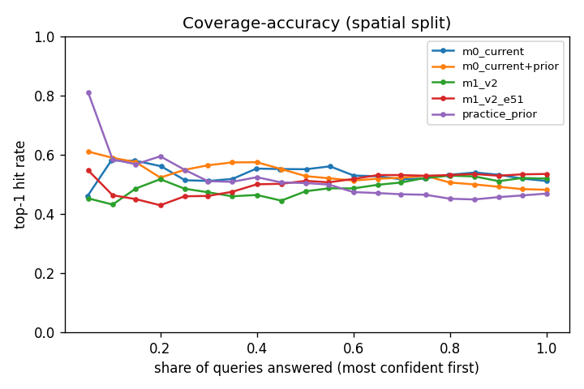
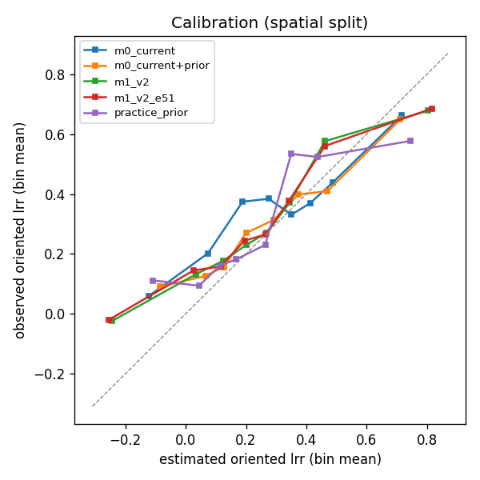
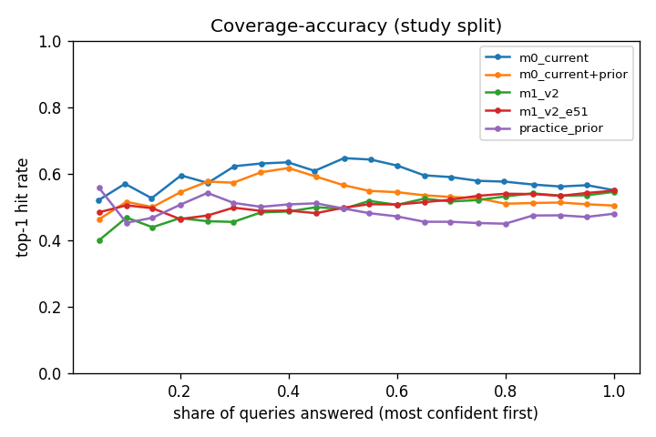
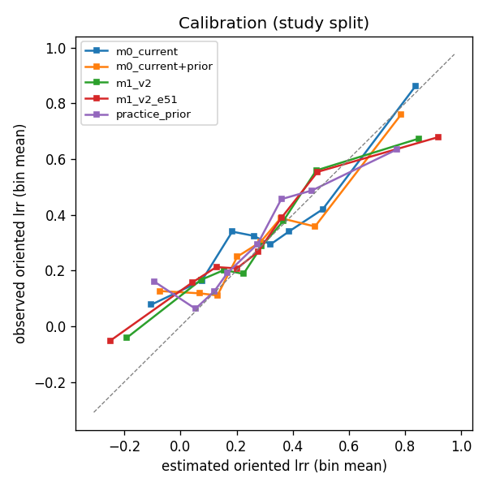

# Evaluation run e6_e51 (2026-11-12)

Query set `ET`: 375 queries; methods: m1_v2, m0_current, practice_prior, m1_v2_e51; splits: spatial, study; 5 repetitions x 5 folds. Generated by `model/harness/run.py`; every number is in `model/harness/runs/e6_e51/metrics.json`. Do not edit by hand.

How to read this. Every method answered the same queries: one query is one study site, one outcome and the practices that study compared, and the method had to rank those practices from the site's context alone, never seeing the study's own rows, passages or graph edges. Top-1 hit is how often the method's first choice was the practice that did best in the trial (chance is what guessing would give); the C-index is the share of practice pairs it ordered the right way (0.5 is a coin flip); NDCG@3 rewards putting strong practices in the top three; the median Spearman is the typical rank agreement within a query. RMSE, sign accuracy and the 80 % interval figures apply only to methods that give a number. 'Abstained' is the share of queries a method declined; its other figures are computed on the queries it answered. Figures are the mean across the fold repetitions with the spread (sd) that fold choice alone produces; the bracket is a bootstrap interval over queries. The spatial split holds out whole 1-degree blocks, which is the harder and more honest test for a new site; the study split holds out papers.

Random expectation on these queries: top-1 39.6%, top-half 57.0%, C-index 0.500, NDCG@3 0.753, median Spearman 0.

Full coverage (E5 Part 0): every method is scored on all queries; where a method abstained, its ranking is filled by `practice_prior` and the method is labelled `<method>+prior`. The common subset is the set of queries every compared method answered in every repetition. Paired differences are query-level bootstrap intervals (1,000 draws) of the mean difference; a method beats another only when the interval excludes zero on the spatial split.

## Headline, full coverage (spatial split)

| method | n queries | top-1 hit | chance | top-half | C-index | NDCG@3 | Spearman (median) | RMSE lrr | sign acc. | 80% coverage | 80% width | abstained |
|---|---:|---:|---:|---:|---:|---:|---:|---:|---:|---:|---:|---:|
| m0_current+prior | 375 | 48.2% +- 1.2% [43.5%, 53.2%] | 39.6% +- 0.0% | 65.7% +- 1.8% | 0.578 +- 0.012 [0.539, 0.616] | 0.797 +- 0.003 | 0.500 +- 0.000 | 0.456 +- 0.002 | 76.2% +- 0.8% | 47.9% +- 0.5% | 0.648 +- 0.003 | 0.0% +- 0.0% |
| m1_v2 | 375 | 51.9% +- 2.4% [47.8%, 56.2%] | 39.6% +- 0.0% | 68.3% +- 2.4% | 0.603 +- 0.019 [0.570, 0.637] | 0.830 +- 0.010 | 0.500 +- 0.000 | 0.448 +- 0.004 | 77.0% +- 1.1% | 81.7% +- 1.1% | 1.301 +- 0.043 | 0.0% +- 0.0% |
| m1_v2_e51 | 375 | 53.5% +- 1.9% [49.8%, 57.3%] | 39.6% +- 0.0% | 69.3% +- 1.5% | 0.614 +- 0.008 [0.585, 0.645] | 0.843 +- 0.017 | 0.500 +- 0.000 | 0.450 +- 0.003 | 76.5% +- 0.6% | 82.8% +- 0.7% | 1.373 +- 0.031 | 0.0% +- 0.0% |
| practice_prior | 375 | 46.9% +- 2.2% [42.1%, 51.6%] | 39.6% +- 0.0% | 65.4% +- 1.4% | 0.578 +- 0.012 [0.536, 0.616] | 0.798 +- 0.007 | 0.500 +- 0.000 | 0.460 +- 0.004 | 74.8% +- 0.4% | 12.9% +- 0.5% | 0.132 +- 0.004 | 0.0% +- 0.0% |

## Headline, full coverage (study split)

| method | n queries | top-1 hit | chance | top-half | C-index | NDCG@3 | Spearman (median) | RMSE lrr | sign acc. | 80% coverage | 80% width | abstained |
|---|---:|---:|---:|---:|---:|---:|---:|---:|---:|---:|---:|---:|
| m0_current+prior | 375 | 50.5% +- 1.0% [45.8%, 55.5%] | 39.6% +- 0.0% | 67.4% +- 1.0% | 0.596 +- 0.009 [0.558, 0.634] | 0.812 +- 0.001 | 0.500 +- 0.000 | 0.448 +- 0.003 | 76.0% +- 0.5% | 48.6% +- 0.4% | 0.648 +- 0.003 | 0.0% +- 0.0% |
| m1_v2 | 375 | 54.6% +- 1.7% [50.1%, 58.7%] | 39.6% +- 0.0% | 69.4% +- 2.4% | 0.618 +- 0.019 [0.583, 0.652] | 0.844 +- 0.017 | 0.500 +- 0.000 | 0.446 +- 0.014 | 78.5% +- 1.8% | 80.0% +- 0.3% | 1.268 +- 0.034 | 0.0% +- 0.0% |
| m1_v2_e51 | 375 | 54.9% +- 2.5% [50.6%, 59.3%] | 39.6% +- 0.0% | 70.0% +- 2.2% | 0.618 +- 0.020 [0.583, 0.653] | 0.858 +- 0.017 | 0.500 +- 0.000 | 0.453 +- 0.011 | 77.6% +- 1.4% | 81.3% +- 0.5% | 1.360 +- 0.018 | 0.0% +- 0.0% |
| practice_prior | 375 | 48.0% +- 1.3% [43.1%, 52.9%] | 39.6% +- 0.0% | 65.0% +- 1.9% | 0.575 +- 0.011 [0.534, 0.612] | 0.809 +- 0.005 | 0.500 +- 0.000 | 0.456 +- 0.002 | 74.6% +- 0.3% | 13.0% +- 0.4% | 0.137 +- 0.005 | 0.0% +- 0.0% |

## Common subset (spatial split, n = 203 queries answered by every method)

| method | n queries | top-1 hit | chance | top-half | C-index | NDCG@3 | Spearman (median) | RMSE lrr | sign acc. | 80% coverage | 80% width | abstained |
|---|---:|---:|---:|---:|---:|---:|---:|---:|---:|---:|---:|---:|

## Common subset (study split, n = 203 queries answered by every method)

| method | n queries | top-1 hit | chance | top-half | C-index | NDCG@3 | Spearman (median) | RMSE lrr | sign acc. | 80% coverage | 80% width | abstained |
|---|---:|---:|---:|---:|---:|---:|---:|---:|---:|---:|---:|---:|

## Paired differences (a minus b; mean [95 % bootstrap]; * = interval excludes zero)

| pair | split | n | top-1 hit | C-index | NDCG@3 |
|---|---|---:|---:|---:|---:|
| m0_current+prior vs m1_v2 | spatial | 375 | -0.038 [-0.077, +0.001] | -0.026 [-0.055, +0.005] | -0.033 [-0.053, -0.017]* |
| m0_current+prior vs m1_v2 | study | 375 | -0.041 [-0.076, -0.005]* | -0.022 [-0.051, +0.009] | -0.033 [-0.046, -0.019]* |
| m0_current+prior vs m1_v2_e51 | spatial | 375 | -0.053 [-0.098, -0.014]* | -0.037 [-0.067, -0.003]* | -0.046 [-0.065, -0.028]* |
| m0_current+prior vs m1_v2_e51 | study | 375 | -0.045 [-0.089, -0.001]* | -0.022 [-0.056, +0.014] | -0.046 [-0.062, -0.030]* |
| m0_current+prior vs practice_prior | spatial | 375 | +0.013 [-0.019, +0.044] | -0.001 [-0.028, +0.027] | -0.001 [-0.013, +0.013] |
| m0_current+prior vs practice_prior | study | 375 | +0.025 [-0.004, +0.055] | +0.021 [-0.003, +0.048] | +0.002 [-0.008, +0.012] |
| m1_v2 vs m1_v2_e51 | spatial | 375 | -0.015 [-0.037, +0.007] | -0.011 [-0.031, +0.008] | -0.013 [-0.020, -0.005]* |
| m1_v2 vs m1_v2_e51 | study | 375 | -0.004 [-0.030, +0.026] | -0.000 [-0.023, +0.023] | -0.014 [-0.023, -0.005]* |
| m1_v2 vs practice_prior | spatial | 375 | +0.051 [+0.020, +0.085]* | +0.025 [+0.002, +0.048]* | +0.032 [+0.019, +0.047]* |
| m1_v2 vs practice_prior | study | 375 | +0.066 [+0.037, +0.096]* | +0.043 [+0.020, +0.067]* | +0.035 [+0.022, +0.048]* |
| m1_v2_e51 vs practice_prior | spatial | 375 | +0.066 [+0.029, +0.105]* | +0.036 [+0.005, +0.067]* | +0.045 [+0.029, +0.061]* |
| m1_v2_e51 vs practice_prior | study | 375 | +0.069 [+0.029, +0.112]* | +0.043 [+0.010, +0.076]* | +0.049 [+0.034, +0.065]* |

## Per-method answered metrics (secondary: each method on the queries it answered)

### Answered (spatial split)

| method | n queries | top-1 hit | chance | top-half | C-index | NDCG@3 | Spearman (median) | RMSE lrr | sign acc. | 80% coverage | 80% width | abstained |
|---|---:|---:|---:|---:|---:|---:|---:|---:|---:|---:|---:|---:|
| m0_current | 375 | 51.1% +- 1.7% [44.9%, 57.4%] | 39.1% +- 0.0% | 68.4% +- 2.3% | 0.601 +- 0.017 [0.546, 0.650] | 0.830 +- 0.006 | 0.500 +- 0.000 | 0.472 +- 0.004 | 77.6% +- 1.5% | 76.5% +- 0.5% | 1.080 +- 0.002 | 45.9% +- 0.0% |
| m0_current+prior | 375 | 48.2% +- 1.2% [43.5%, 53.2%] | 39.6% +- 0.0% | 65.7% +- 1.8% | 0.578 +- 0.012 [0.539, 0.616] | 0.797 +- 0.003 | 0.500 +- 0.000 | 0.456 +- 0.002 | 76.2% +- 0.8% | 47.9% +- 0.5% | 0.648 +- 0.003 | 0.0% +- 0.0% |
| m1_v2 | 375 | 51.9% +- 2.4% [47.8%, 56.2%] | 39.6% +- 0.0% | 68.3% +- 2.4% | 0.603 +- 0.019 [0.570, 0.637] | 0.830 +- 0.010 | 0.500 +- 0.000 | 0.448 +- 0.004 | 77.0% +- 1.1% | 81.7% +- 1.1% | 1.301 +- 0.043 | 0.0% +- 0.0% |
| m1_v2_e51 | 375 | 53.5% +- 1.9% [49.8%, 57.3%] | 39.6% +- 0.0% | 69.3% +- 1.5% | 0.614 +- 0.008 [0.585, 0.645] | 0.843 +- 0.017 | 0.500 +- 0.000 | 0.450 +- 0.003 | 76.5% +- 0.6% | 82.8% +- 0.7% | 1.373 +- 0.031 | 0.0% +- 0.0% |
| practice_prior | 375 | 46.9% +- 2.2% [42.1%, 51.6%] | 39.6% +- 0.0% | 65.4% +- 1.4% | 0.578 +- 0.012 [0.536, 0.616] | 0.798 +- 0.007 | 0.500 +- 0.000 | 0.460 +- 0.004 | 74.8% +- 0.4% | 12.9% +- 0.5% | 0.132 +- 0.004 | 0.0% +- 0.0% |

### Answered (study split)

| method | n queries | top-1 hit | chance | top-half | C-index | NDCG@3 | Spearman (median) | RMSE lrr | sign acc. | 80% coverage | 80% width | abstained |
|---|---:|---:|---:|---:|---:|---:|---:|---:|---:|---:|---:|---:|
| m0_current | 375 | 55.1% +- 1.9% [49.2%, 61.5%] | 39.1% +- 0.0% | 71.5% +- 1.2% | 0.636 +- 0.013 [0.585, 0.686] | 0.853 +- 0.005 | 0.560 +- 0.069 | 0.452 +- 0.007 | 77.9% +- 0.8% | 78.0% +- 0.7% | 1.077 +- 0.004 | 45.9% +- 0.0% |
| m0_current+prior | 375 | 50.5% +- 1.0% [45.8%, 55.5%] | 39.6% +- 0.0% | 67.4% +- 1.0% | 0.596 +- 0.009 [0.558, 0.634] | 0.812 +- 0.001 | 0.500 +- 0.000 | 0.448 +- 0.003 | 76.0% +- 0.5% | 48.6% +- 0.4% | 0.648 +- 0.003 | 0.0% +- 0.0% |
| m1_v2 | 375 | 54.6% +- 1.7% [50.1%, 58.7%] | 39.6% +- 0.0% | 69.4% +- 2.4% | 0.618 +- 0.019 [0.583, 0.652] | 0.844 +- 0.017 | 0.500 +- 0.000 | 0.446 +- 0.014 | 78.5% +- 1.8% | 80.0% +- 0.3% | 1.268 +- 0.034 | 0.0% +- 0.0% |
| m1_v2_e51 | 375 | 54.9% +- 2.5% [50.6%, 59.3%] | 39.6% +- 0.0% | 70.0% +- 2.2% | 0.618 +- 0.020 [0.583, 0.653] | 0.858 +- 0.017 | 0.500 +- 0.000 | 0.453 +- 0.011 | 77.6% +- 1.4% | 81.3% +- 0.5% | 1.360 +- 0.018 | 0.0% +- 0.0% |
| practice_prior | 375 | 48.0% +- 1.3% [43.1%, 52.9%] | 39.6% +- 0.0% | 65.0% +- 1.9% | 0.575 +- 0.011 [0.534, 0.612] | 0.809 +- 0.005 | 0.500 +- 0.000 | 0.456 +- 0.002 | 74.6% +- 0.3% | 13.0% +- 0.4% | 0.137 +- 0.005 | 0.0% +- 0.0% |

## Figures (spatial split)

## Figures (study split)

## Breakdowns

Cells with fewer than 20 queries are shown as `n < 20`.

### Objective group (spatial split; top-1 hit / C-index)

| cell | n | m0_current | m0_current+prior | m1_v2 | m1_v2_e51 | practice_prior |
|---|---:|---:|---:|---:|---:|---:|
| economics | 9 | n < 20 / n < 20 | 0.35 / 0.52 | 0.58 / 0.63 | 0.64 / 0.67 | 0.39 / 0.54 |
| livestock | 34 | - / - | 0.56 / 0.53 | 0.56 / 0.52 | 0.44 / 0.39 | 0.56 / 0.53 |
| productivity | 152 | 0.51 / 0.62 | 0.50 / 0.60 | 0.48 / 0.62 | 0.48 / 0.62 | 0.48 / 0.61 |
| resilience_biodiversity | 3 | - / - | n < 20 / n < 20 | n < 20 / n < 20 | n < 20 / n < 20 | n < 20 / n < 20 |
| soil_health | 5 | n < 20 / n < 20 | 0.58 / 0.65 | 0.54 / 0.64 | 0.56 / 0.64 | 0.61 / 0.69 |
| water | 37 | 0.52 / 0.55 | 0.52 / 0.59 | 0.54 / 0.52 | 0.64 / 0.65 | 0.43 / 0.48 |

### Challenge (a query counts in every challenge of its outcome) (spatial split; top-1 hit / C-index)

| cell | n | m0_current | m0_current+prior | m1_v2 | m1_v2_e51 | practice_prior |
|---|---:|---:|---:|---:|---:|---:|
| DEFORESTATION_FUELWOOD | 2 | - / - | n < 20 / n < 20 | n < 20 / n < 20 | n < 20 / n < 20 | n < 20 / n < 20 |
| DEGRADED_HILLSIDES | 29 | 0.48 / 0.47 | 0.45 / 0.44 | 0.55 / 0.48 | 0.72 / 0.67 | 0.39 / 0.37 |
| FEED_SHORTAGE | 31 | 0.61 / 0.75 | 0.56 / 0.62 | 0.54 / 0.62 | 0.46 / 0.55 | 0.52 / 0.60 |
| GULLY_EROSION | 29 | 0.48 / 0.47 | 0.48 / 0.47 | 0.55 / 0.48 | 0.74 / 0.69 | 0.42 / 0.40 |
| LOW_CROP_PRODUCTIVITY | 152 | 0.51 / 0.62 | 0.52 / 0.62 | 0.49 / 0.63 | 0.49 / 0.63 | 0.50 / 0.64 |
| LOW_INCOME_MARKET_ACCESS | 9 | n < 20 / n < 20 | 0.38 / 0.51 | 0.60 / 0.65 | 0.67 / 0.70 | 0.43 / 0.53 |
| MOISTURE_STRESS_DROUGHT | 129 | 0.50 / 0.61 | 0.51 / 0.62 | 0.46 / 0.60 | 0.48 / 0.61 | 0.48 / 0.63 |
| PESTS_AND_DISEASES | 1 | - / - | n < 20 / n < 20 | n < 20 / n < 20 | n < 20 / n < 20 | n < 20 / n < 20 |
| SOIL_ACIDITY | 121 | 0.49 / 0.59 | 0.49 / 0.59 | 0.46 / 0.61 | 0.49 / 0.62 | 0.49 / 0.63 |
| SOIL_EROSION | 29 | 0.48 / 0.47 | 0.46 / 0.46 | 0.55 / 0.48 | 0.73 / 0.68 | 0.41 / 0.38 |
| SOIL_FERTILITY_DECLINE | 126 | 0.48 / 0.58 | 0.51 / 0.60 | 0.48 / 0.62 | 0.50 / 0.62 | 0.51 / 0.64 |
| WATERLOGGING_EXCESS_RUNOFF | 29 | 0.48 / 0.47 | 0.48 / 0.47 | 0.55 / 0.48 | 0.74 / 0.69 | 0.42 / 0.40 |
| WATER_SCARCITY_IRRIGATION | 8 | n < 20 / n < 20 | n < 20 / n < 20 | n < 20 / n < 20 | n < 20 / n < 20 | n < 20 / n < 20 |
| none | 42 | - / - | 0.32 / 0.48 | 0.53 / 0.58 | 0.53 / 0.58 | 0.32 / 0.48 |

### Belt (attribute only) (spatial split; top-1 hit / C-index)

| cell | n | m0_current | m0_current+prior | m1_v2 | m1_v2_e51 | practice_prior |
|---|---:|---:|---:|---:|---:|---:|
| Dry Dega | 9 | n < 20 / n < 20 | n < 20 / n < 20 | n < 20 / n < 20 | n < 20 / n < 20 | n < 20 / n < 20 |
| Dry Kolla | 17 | n < 20 / n < 20 | 0.35 / 0.42 | 0.31 / 0.41 | 0.41 / 0.48 | 0.31 / 0.38 |
| Dry Weyna Dega | 51 | 0.42 / 0.49 | 0.42 / 0.51 | 0.46 / 0.53 | 0.51 / 0.57 | 0.45 / 0.56 |
| Moist Dega | 20 | 0.36 / 0.63 | 0.27 / 0.51 | 0.30 / 0.53 | 0.32 / 0.56 | 0.26 / 0.51 |
| Moist High Dega | 2 | n < 20 / n < 20 | n < 20 / n < 20 | n < 20 / n < 20 | n < 20 / n < 20 | n < 20 / n < 20 |
| Moist Kolla | 3 | n < 20 / n < 20 | n < 20 / n < 20 | n < 20 / n < 20 | n < 20 / n < 20 | n < 20 / n < 20 |
| Moist Weyna Dega | 57 | 0.61 / 0.62 | 0.56 / 0.60 | 0.65 / 0.65 | 0.66 / 0.67 | 0.54 / 0.59 |
| Wet Dega | 8 | n < 20 / n < 20 | n < 20 / n < 20 | n < 20 / n < 20 | n < 20 / n < 20 | n < 20 / n < 20 |
| Wet Kolla | 2 | n < 20 / n < 20 | n < 20 / n < 20 | n < 20 / n < 20 | n < 20 / n < 20 | n < 20 / n < 20 |
| Wet Weyna Dega | 34 | 0.63 / 0.73 | 0.55 / 0.68 | 0.52 / 0.68 | 0.52 / 0.66 | 0.53 / 0.68 |
| none | 1 | - / - | n < 20 / n < 20 | n < 20 / n < 20 | n < 20 / n < 20 | n < 20 / n < 20 |

### Source (spatial split; top-1 hit / C-index)

| cell | n | m0_current | m0_current+prior | m1_v2 | m1_v2_e51 | practice_prior |
|---|---:|---:|---:|---:|---:|---:|
| CSA | 30 | 0.50 / 0.45 | 0.46 / 0.42 | 0.59 / 0.51 | 0.58 / 0.55 | 0.41 / 0.37 |
| ERA | 170 | 0.51 / 0.62 | 0.48 / 0.59 | 0.51 / 0.61 | 0.53 / 0.62 | 0.47 / 0.60 |
| HAB | 3 | n < 20 / n < 20 | n < 20 / n < 20 | n < 20 / n < 20 | n < 20 / n < 20 | n < 20 / n < 20 |

### Location precision (spatial split; top-1 hit / C-index)

| cell | n | m0_current | m0_current+prior | m1_v2 | m1_v2_e51 | practice_prior |
|---|---:|---:|---:|---:|---:|---:|
| site | 203 | 0.51 / 0.60 | 0.48 / 0.58 | 0.52 / 0.60 | 0.53 / 0.61 | 0.47 / 0.58 |

### ET versus global (spatial split; top-1 hit / C-index)

| cell | n | m0_current | m0_current+prior | m1_v2 | m1_v2_e51 | practice_prior |
|---|---:|---:|---:|---:|---:|---:|
| ET | 203 | 0.51 / 0.60 | 0.48 / 0.58 | 0.52 / 0.60 | 0.53 / 0.61 | 0.47 / 0.58 |

### Published 2024 or later (memorisation check) (spatial split; top-1 hit / C-index)

| cell | n | m0_current | m0_current+prior | m1_v2 | m1_v2_e51 | practice_prior |
|---|---:|---:|---:|---:|---:|---:|
| False | 203 | 0.51 / 0.60 | 0.48 / 0.58 | 0.52 / 0.60 | 0.53 / 0.61 | 0.47 / 0.58 |

### Objective group (study split; top-1 hit / C-index)

| cell | n | m0_current | m0_current+prior | m1_v2 | m1_v2_e51 | practice_prior |
|---|---:|---:|---:|---:|---:|---:|
| economics | 9 | n < 20 / n < 20 | 0.34 / 0.51 | 0.57 / 0.64 | 0.65 / 0.70 | 0.35 / 0.52 |
| livestock | 34 | - / - | 0.56 / 0.53 | 0.50 / 0.51 | 0.52 / 0.48 | 0.56 / 0.53 |
| productivity | 152 | 0.54 / 0.64 | 0.52 / 0.62 | 0.54 / 0.63 | 0.49 / 0.59 | 0.51 / 0.62 |
| resilience_biodiversity | 3 | - / - | n < 20 / n < 20 | n < 20 / n < 20 | n < 20 / n < 20 | n < 20 / n < 20 |
| soil_health | 5 | n < 20 / n < 20 | 0.60 / 0.64 | 0.51 / 0.63 | 0.53 / 0.62 | 0.62 / 0.66 |
| water | 37 | 0.59 / 0.64 | 0.61 / 0.68 | 0.60 / 0.60 | 0.68 / 0.69 | 0.43 / 0.49 |

### Challenge (a query counts in every challenge of its outcome) (study split; top-1 hit / C-index)

| cell | n | m0_current | m0_current+prior | m1_v2 | m1_v2_e51 | practice_prior |
|---|---:|---:|---:|---:|---:|---:|
| DEFORESTATION_FUELWOOD | 2 | - / - | n < 20 / n < 20 | n < 20 / n < 20 | n < 20 / n < 20 | n < 20 / n < 20 |
| DEGRADED_HILLSIDES | 29 | 0.57 / 0.58 | 0.54 / 0.54 | 0.57 / 0.53 | 0.69 / 0.66 | 0.37 / 0.35 |
| FEED_SHORTAGE | 31 | 0.66 / 0.75 | 0.57 / 0.63 | 0.55 / 0.61 | 0.47 / 0.54 | 0.55 / 0.61 |
| GULLY_EROSION | 29 | 0.57 / 0.58 | 0.57 / 0.58 | 0.60 / 0.55 | 0.72 / 0.69 | 0.39 / 0.37 |
| LOW_CROP_PRODUCTIVITY | 152 | 0.54 / 0.64 | 0.54 / 0.64 | 0.55 / 0.65 | 0.51 / 0.61 | 0.53 / 0.64 |
| LOW_INCOME_MARKET_ACCESS | 9 | n < 20 / n < 20 | 0.37 / 0.48 | 0.58 / 0.65 | 0.66 / 0.72 | 0.39 / 0.49 |
| MOISTURE_STRESS_DROUGHT | 129 | 0.52 / 0.63 | 0.53 / 0.64 | 0.54 / 0.65 | 0.53 / 0.63 | 0.50 / 0.64 |
| PESTS_AND_DISEASES | 1 | - / - | n < 20 / n < 20 | n < 20 / n < 20 | n < 20 / n < 20 | n < 20 / n < 20 |
| SOIL_ACIDITY | 121 | 0.51 / 0.61 | 0.52 / 0.62 | 0.54 / 0.64 | 0.52 / 0.63 | 0.51 / 0.63 |
| SOIL_EROSION | 29 | 0.57 / 0.58 | 0.55 / 0.56 | 0.59 / 0.54 | 0.71 / 0.68 | 0.38 / 0.36 |
| SOIL_FERTILITY_DECLINE | 126 | 0.51 / 0.60 | 0.53 / 0.62 | 0.53 / 0.64 | 0.53 / 0.63 | 0.53 / 0.64 |
| WATERLOGGING_EXCESS_RUNOFF | 29 | 0.57 / 0.58 | 0.57 / 0.58 | 0.60 / 0.55 | 0.72 / 0.69 | 0.39 / 0.37 |
| WATER_SCARCITY_IRRIGATION | 8 | n < 20 / n < 20 | n < 20 / n < 20 | n < 20 / n < 20 | n < 20 / n < 20 | n < 20 / n < 20 |
| none | 42 | - / - | 0.34 / 0.52 | 0.50 / 0.56 | 0.54 / 0.55 | 0.34 / 0.52 |

### Belt (attribute only) (study split; top-1 hit / C-index)

| cell | n | m0_current | m0_current+prior | m1_v2 | m1_v2_e51 | practice_prior |
|---|---:|---:|---:|---:|---:|---:|
| Dry Dega | 9 | n < 20 / n < 20 | n < 20 / n < 20 | n < 20 / n < 20 | n < 20 / n < 20 | n < 20 / n < 20 |
| Dry Kolla | 17 | n < 20 / n < 20 | 0.33 / 0.44 | 0.32 / 0.41 | 0.39 / 0.50 | 0.31 / 0.38 |
| Dry Weyna Dega | 51 | 0.50 / 0.57 | 0.47 / 0.56 | 0.49 / 0.56 | 0.53 / 0.58 | 0.44 / 0.55 |
| Moist Dega | 20 | 0.54 / 0.70 | 0.35 / 0.55 | 0.36 / 0.53 | 0.38 / 0.59 | 0.31 / 0.51 |
| Moist High Dega | 2 | n < 20 / n < 20 | n < 20 / n < 20 | n < 20 / n < 20 | n < 20 / n < 20 | n < 20 / n < 20 |
| Moist Kolla | 3 | n < 20 / n < 20 | n < 20 / n < 20 | n < 20 / n < 20 | n < 20 / n < 20 | n < 20 / n < 20 |
| Moist Weyna Dega | 57 | 0.59 / 0.63 | 0.55 / 0.60 | 0.62 / 0.63 | 0.64 / 0.65 | 0.54 / 0.58 |
| Wet Dega | 8 | n < 20 / n < 20 | n < 20 / n < 20 | n < 20 / n < 20 | n < 20 / n < 20 | n < 20 / n < 20 |
| Wet Kolla | 2 | n < 20 / n < 20 | n < 20 / n < 20 | n < 20 / n < 20 | n < 20 / n < 20 | n < 20 / n < 20 |
| Wet Weyna Dega | 34 | 0.62 / 0.74 | 0.56 / 0.68 | 0.59 / 0.74 | 0.52 / 0.67 | 0.54 / 0.68 |
| none | 1 | - / - | n < 20 / n < 20 | n < 20 / n < 20 | n < 20 / n < 20 | n < 20 / n < 20 |

### Source (study split; top-1 hit / C-index)

| cell | n | m0_current | m0_current+prior | m1_v2 | m1_v2_e51 | practice_prior |
|---|---:|---:|---:|---:|---:|---:|
| CSA | 30 | 0.48 / 0.43 | 0.47 / 0.43 | 0.57 / 0.51 | 0.52 / 0.49 | 0.41 / 0.37 |
| ERA | 170 | 0.56 / 0.67 | 0.50 / 0.61 | 0.54 / 0.63 | 0.55 / 0.63 | 0.48 / 0.59 |
| HAB | 3 | n < 20 / n < 20 | n < 20 / n < 20 | n < 20 / n < 20 | n < 20 / n < 20 | n < 20 / n < 20 |

### Location precision (study split; top-1 hit / C-index)

| cell | n | m0_current | m0_current+prior | m1_v2 | m1_v2_e51 | practice_prior |
|---|---:|---:|---:|---:|---:|---:|
| site | 203 | 0.55 / 0.64 | 0.50 / 0.60 | 0.55 / 0.62 | 0.55 / 0.62 | 0.48 / 0.58 |

### ET versus global (study split; top-1 hit / C-index)

| cell | n | m0_current | m0_current+prior | m1_v2 | m1_v2_e51 | practice_prior |
|---|---:|---:|---:|---:|---:|---:|
| ET | 203 | 0.55 / 0.64 | 0.50 / 0.60 | 0.55 / 0.62 | 0.55 / 0.62 | 0.48 / 0.58 |

### Published 2024 or later (memorisation check) (study split; top-1 hit / C-index)

| cell | n | m0_current | m0_current+prior | m1_v2 | m1_v2_e51 | practice_prior |
|---|---:|---:|---:|---:|---:|---:|
| False | 203 | 0.55 / 0.64 | 0.50 / 0.60 | 0.55 / 0.62 | 0.55 / 0.62 | 0.48 / 0.58 |

## Masking

No chunk without study metadata was met under a mask.

## Configuration

| key | value |
|---|---|
| run_id | `e6_e51` |
| query_hash | `81c29a8f17b7b1079863b522734a192b4805e47474d8a70e8fcc0bffb2f448fd` |
| index_hash | `3dc545151183d96c6953a613ae18099c75972ea916f6c9895dd664b4ed476f2e` |
| release | `ET/2026.1` |
| git_commit | `3644d5929787bd3c1e9d47c688c0be8f541406d5+dirty` |
| seed | `0` |
| started_utc | `2026-11-11T17:51:50+00:00` |
| elapsed_s | `4239.2` |
| folds spatial | `data\evidence\harness\folds_spatial.csv` sha256 `11e29e68727c` |
| folds study | `data\evidence\harness\folds_study.csv` sha256 `8eff0fcbe3cf` |
| m1_v2 | `{"data": {"context": "all", "use_belt": true, "use_koppen": true, "use_components": true, "use_practice_te": true, "include_hab": true, "include_country_precision": true, "weight_scheme": "inverse_variance", "te_smoothing": 10.0}, "use_regressor": true, "use_ranker": true, "use_matched": true, "stac` |
| m0_current | `{"spec": "HistGBM(learning_rate=0.03,max_iter=400,min_samples_leaf=50)", "dataset": "data\\processed\\CSA_ERA_final_model_ready.csv", "features": ["CSA_practices", "practice_family", "Crop_group", "crop_type", "aez_belt", "Indicator", "land_cover", "Rainfall", "Altitude_r", "temp_mean_annual", "prec` |
| practice_prior | `{"interval": "mean +- 1.28 sd/sqrt(n)", "fallbacks": ["family_group", "practice_all"], "source_run": "e5_headline"}` |
| m1_v2_e51 | `{"data": {"context": "all", "use_belt": true, "use_koppen": true, "use_components": true, "use_practice_te": true, "include_hab": true, "include_country_precision": true, "weight_scheme": "inverse_variance", "te_smoothing": 10.0}, "use_regressor": true, "use_ranker": true, "use_matched": true, "stac` |
| time practice_prior:spatial | 4.5 s |
| time nearest_studies:spatial | 41.8 s |
| time m0_current:spatial | 112.8 s |
| time m1_v2:spatial | 2162.6 s |
| time practice_prior:study | 4.1 s |
| time nearest_studies:study | 40.5 s |
| time m0_current:study | 104.4 s |
| time m1_v2:study | 1752.6 s |
