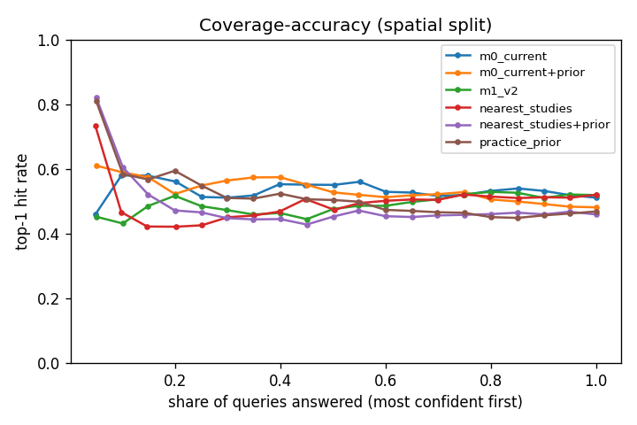
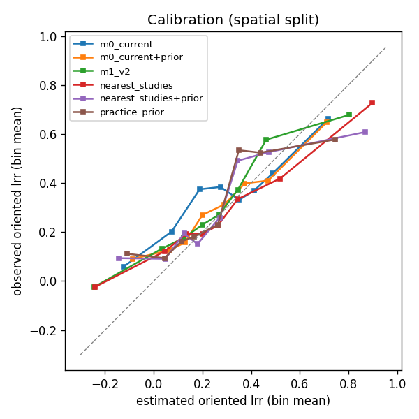

# Evaluation: Methodology 1 v2 (E5, 2026-11-12)

Generated by `model/m1/report.py` from the harness runs `e5_headline`, `e5_components`, `e5_ablations`, `e5_all`, `e5_legacy68`, `e5_headline_b`. ET set: 375 queries; folds and queries of E4 (query hash `81c29a8f17b7`, Tier 1 index hash `3dc545151183`, release `ET/2026.1`); 5 repetitions x 5 folds per split. Do not edit by hand.

How to read this. Every method ranks the same held-out queries from the site's context alone. **Full coverage** is the headline: a method that abstains is filled by the practice prior on those queries and shown as `<method>+prior`. The **common subset** compares the methods only on queries all of them answered. **Paired differences** are bootstrap intervals over queries of M1 v2 minus the other method; an asterisk means the interval excludes zero. Top-1 is how often the first choice was the trial's best practice; the C-index is the share of practice pairs ordered right (0.5 = coin); 80 % coverage is the share of held-out effects inside the method's 80 % interval.

## Success criterion (stated in the brief before any result)

On the ET set, spatial split, full coverage, `m1_v2` beats `practice_prior` and `m0_current+prior` on top-1 hit and C-index (paired bootstrap interval of the difference excludes zero), and its 80 % intervals cover 75 to 85 % of held-out effects.

| requirement | difference [95 %] | met |
|---|---:|---|
| beats `practice_prior` on top-1 | +0.051 [+0.020, +0.085] | yes |
| beats `practice_prior` on C-index | +0.025 [+0.002, +0.048] | yes |
| beats `m0_current+prior` on top-1 | +0.038 [-0.001, +0.077] | **no** |
| beats `m0_current+prior` on C-index | +0.026 [-0.005, +0.055] | **no** |
| 80 % coverage in [0.75, 0.85] | 0.817 | yes |

**Verdict: not met.**

## Headline, full coverage

| method | split | top-1 | chance | C-index | C pooled | NDCG@3 | RMSE | sign acc. | 80 % cov. | 80 % width |
|---|---|---:|---:|---:|---:|---:|---:|---:|---:|---:|
| m1_v2 | spatial | 51.9% ± 2.4% | 39.6% | 0.603 ± 0.019 | 0.624 | 0.830 | 0.448 | 77.0% | 81.7% | 1.301 |
| m1_v2 | study | 54.6% ± 1.7% | 39.6% | 0.618 ± 0.019 | 0.650 | 0.844 | 0.446 | 78.5% | 80.0% | 1.268 |
| practice_prior | spatial | 46.9% ± 2.2% | 39.6% | 0.578 ± 0.012 | 0.588 | 0.798 | 0.460 | 74.8% | 12.9% | 0.132 |
| practice_prior | study | 48.0% ± 1.3% | 39.6% | 0.575 ± 0.011 | 0.615 | 0.809 | 0.456 | 74.6% | 13.0% | 0.137 |
| nearest_studies+prior | spatial | 46.0% ± 1.1% | 39.6% | 0.579 ± 0.004 | 0.582 | 0.785 | 0.473 | 74.4% | 19.4% | 0.239 |
| nearest_studies+prior | study | 48.2% ± 2.3% | 39.6% | 0.581 ± 0.019 | 0.610 | 0.799 | 0.471 | 73.7% | 19.7% | 0.254 |
| m0_current+prior | spatial | 48.2% ± 1.2% | 39.6% | 0.578 ± 0.012 | 0.587 | 0.797 | 0.456 | 76.2% | 47.9% | 0.648 |
| m0_current+prior | study | 50.5% ± 1.0% | 39.6% | 0.596 ± 0.009 | 0.628 | 0.812 | 0.448 | 76.0% | 48.6% | 0.648 |

## Common subset (queries every method answered)

spatial split: n = 87

| method | split | top-1 | chance | C-index | NDCG@3 |
|---|---|---:|---:|---:|---:|
| m1_v2 | spatial | 63.4% ± 2.4% | 45.2% | 0.636 ± 0.020 | 0.948 |
| practice_prior | spatial | 58.6% ± 1.6% | 45.2% | 0.603 ± 0.012 | 0.939 |
| nearest_studies | spatial | 63.0% ± 2.9% | 45.2% | 0.659 ± 0.022 | 0.912 |
| m0_current | spatial | 60.0% ± 1.5% | 45.2% | 0.624 ± 0.013 | 0.948 |

study split: n = 83

| method | split | top-1 | chance | C-index | NDCG@3 |
|---|---|---:|---:|---:|---:|
| m1_v2 | study | 68.4% ± 2.9% | 44.6% | 0.686 ± 0.031 | 0.955 |
| practice_prior | study | 60.0% ± 1.8% | 44.6% | 0.623 ± 0.022 | 0.945 |
| nearest_studies | study | 67.0% ± 3.5% | 44.6% | 0.697 ± 0.022 | 0.918 |
| m0_current | study | 64.1% ± 1.8% | 44.6% | 0.674 ± 0.019 | 0.948 |

## Paired differences

| comparison (M1 v2 minus other) | split | n | top-1 | C-index | NDCG@3 |
|---|---|---:|---:|---:|---:|
| vs m0_current+prior | spatial | 375 | +0.038 [-0.001, +0.077] | +0.026 [-0.005, +0.055] | +0.033 [+0.017, +0.053] * |
| vs m0_current+prior | study | 375 | +0.041 [+0.005, +0.076] * | +0.022 [-0.009, +0.051] | +0.033 [+0.019, +0.046] * |
| vs nearest_studies+prior | spatial | 375 | +0.060 [+0.031, +0.097] * | +0.025 [-0.005, +0.052] | +0.045 [+0.030, +0.060] * |
| vs nearest_studies+prior | study | 375 | +0.064 [+0.030, +0.102] * | +0.037 [+0.005, +0.066] * | +0.045 [+0.032, +0.059] * |
| vs practice_prior | spatial | 375 | +0.051 [+0.020, +0.085] * | +0.025 [+0.002, +0.048] * | +0.032 [+0.019, +0.047] * |
| vs practice_prior | study | 375 | +0.066 [+0.037, +0.096] * | +0.043 [+0.020, +0.067] * | +0.035 [+0.022, +0.048] * |

## Components (each alone, the prior answering what it cannot)

| method | split | top-1 | chance | C-index | C pooled | NDCG@3 | RMSE | sign acc. | 80 % cov. | 80 % width |
|---|---|---:|---:|---:|---:|---:|---:|---:|---:|---:|
| regressor (+ prior fallback) | spatial | 49.2% ± 2.5% | 39.6% | 0.590 ± 0.018 | 0.605 | 0.816 | 0.434 | 79.1% | 80.6% | 1.137 |
| regressor (+ prior fallback) | study | 52.7% ± 1.3% | 39.6% | 0.612 ± 0.010 | 0.636 | 0.832 | 0.430 | 79.2% | 80.9% | 1.149 |
| ranker (+ prior) | spatial | 51.4% ± 1.1% | 39.6% | 0.613 ± 0.008 | 0.623 | 0.829 | 0.444 | 78.5% | 80.9% | 1.177 |
| ranker (+ prior) | study | 51.6% ± 2.0% | 39.6% | 0.603 ± 0.020 | 0.641 | 0.838 | 0.442 | 78.5% | 81.6% | 1.184 |
| matched studies (+ prior) | spatial | 43.8% ± 2.1% | 39.6% | 0.558 ± 0.016 | 0.583 | 0.776 | 0.450 | 79.0% | 80.9% | 1.266 |
| matched studies (+ prior) | study | 43.5% ± 0.8% | 39.6% | 0.552 ± 0.011 | 0.591 | 0.789 | 0.448 | 79.3% | 79.7% | 1.238 |
| shrunken prior alone | spatial | 47.5% ± 2.3% | 39.6% | 0.585 ± 0.012 | 0.604 | 0.806 | 0.449 | 78.5% | 81.0% | 1.185 |
| shrunken prior alone | study | 48.3% ± 0.9% | 39.6% | 0.575 ± 0.010 | 0.620 | 0.815 | 0.445 | 78.5% | 81.7% | 1.191 |
| E4 practice prior | spatial | 46.9% ± 2.2% | 39.6% | 0.578 ± 0.012 | 0.588 | 0.798 | 0.460 | 74.8% | 12.9% | 0.132 |
| E4 practice prior | study | 48.0% ± 1.3% | 39.6% | 0.575 ± 0.011 | 0.615 | 0.809 | 0.456 | 74.6% | 13.0% | 0.137 |

M1 v2 with all components, for reference:

| method | split | top-1 | chance | C-index | C pooled | NDCG@3 | RMSE | sign acc. | 80 % cov. | 80 % width |
|---|---|---:|---:|---:|---:|---:|---:|---:|---:|---:|
| M1 v2 (all components) | spatial | 51.9% ± 2.4% | 39.6% | 0.603 ± 0.019 | 0.624 | 0.830 | 0.448 | 77.0% | 81.7% | 1.301 |
| M1 v2 (all components) | study | 54.6% ± 1.7% | 39.6% | 0.618 ± 0.019 | 0.650 | 0.844 | 0.446 | 78.5% | 80.0% | 1.268 |

## Ablations

| method | split | top-1 | chance | C-index | C pooled | NDCG@3 | RMSE | sign acc. | 80 % cov. | 80 % width |
|---|---|---:|---:|---:|---:|---:|---:|---:|---:|---:|
| M1 v2 (headline) | spatial | 51.9% ± 2.4% | 39.6% | 0.603 ± 0.019 | 0.624 | 0.830 | 0.448 | 77.0% | 81.7% | 1.301 |
| M1 v2 (headline) | study | 54.6% ± 1.7% | 39.6% | 0.618 ± 0.019 | 0.650 | 0.844 | 0.446 | 78.5% | 80.0% | 1.268 |
| no inner tuning or selection | spatial | 50.6% ± 2.5% | 39.6% | 0.595 ± 0.020 | 0.619 | 0.825 | 0.449 | 77.6% | 81.5% | 1.290 |
| no inner tuning or selection | study | 52.6% ± 2.5% | 39.6% | 0.605 ± 0.015 | 0.643 | 0.836 | 0.448 | 78.0% | 79.5% | 1.255 |
| belt removed | spatial | 51.8% ± 2.3% | 39.6% | 0.604 ± 0.022 | 0.620 | 0.827 | 0.456 | 77.6% | 81.7% | 1.301 |
| belt removed | study | 52.4% ± 1.8% | 39.6% | 0.600 ± 0.007 | 0.646 | 0.840 | 0.445 | 78.6% | 79.4% | 1.244 |
| context: 11 legacy layers | spatial | 50.0% ± 2.1% | 39.6% | 0.602 ± 0.006 | 0.621 | 0.825 | 0.454 | 77.6% | 81.5% | 1.299 |
| context: 11 legacy layers | study | 53.1% ± 2.2% | 39.6% | 0.609 ± 0.020 | 0.643 | 0.838 | 0.446 | 78.7% | 79.7% | 1.250 |
| Habtamu rows removed | spatial | 52.8% ± 2.7% | 39.6% | 0.609 ± 0.015 | 0.631 | 0.834 | 0.448 | 77.4% | 82.1% | 1.284 |
| Habtamu rows removed | study | 53.2% ± 3.3% | 39.6% | 0.597 ± 0.019 | 0.638 | 0.841 | 0.450 | 77.0% | 80.3% | 1.256 |
| country-precision rows removed | spatial | 52.3% ± 0.5% | 39.6% | 0.602 ± 0.005 | 0.625 | 0.835 | 0.445 | 78.7% | 81.7% | 1.267 |
| country-precision rows removed | study | 52.3% ± 1.6% | 39.6% | 0.603 ± 0.016 | 0.650 | 0.845 | 0.446 | 78.1% | 78.8% | 1.201 |
| weights: quality default | spatial | 52.0% ± 2.0% | 39.6% | 0.606 ± 0.016 | 0.628 | 0.832 | 0.442 | 78.2% | 82.4% | 1.297 |
| weights: quality default | study | 52.9% ± 1.4% | 39.6% | 0.601 ± 0.012 | 0.636 | 0.836 | 0.448 | 77.6% | 79.5% | 1.257 |
| ranker removed | spatial | 48.5% ± 1.3% | 39.6% | 0.577 ± 0.012 | 0.599 | 0.813 | 0.448 | 77.2% | 81.8% | 1.275 |
| ranker removed | study | 48.7% ± 1.6% | 39.6% | 0.584 ± 0.012 | 0.623 | 0.824 | 0.439 | 78.5% | 80.2% | 1.238 |
| matched studies removed | spatial | 51.6% ± 2.1% | 39.6% | 0.610 ± 0.009 | 0.624 | 0.826 | 0.447 | 77.3% | 80.3% | 1.184 |
| matched studies removed | study | 52.7% ± 1.9% | 39.6% | 0.609 ± 0.011 | 0.641 | 0.838 | 0.442 | 78.1% | 80.7% | 1.196 |
| stacker: rank averaging | spatial | 52.6% ± 2.2% | 39.6% | 0.610 ± 0.015 | 0.631 | 0.832 | 0.457 | 76.3% | 81.5% | 1.308 |
| stacker: rank averaging | study | 53.4% ± 1.4% | 39.6% | 0.605 ± 0.014 | 0.640 | 0.841 | 0.449 | 77.7% | 79.5% | 1.277 |
| stacker: ridge forced | spatial | 46.2% ± 2.5% | 39.6% | 0.569 ± 0.017 | 0.594 | 0.802 | 0.439 | 79.4% | 80.9% | 1.226 |
| stacker: ridge forced | study | 48.9% ± 1.5% | 39.6% | 0.588 ± 0.007 | 0.624 | 0.817 | 0.433 | 79.3% | 80.3% | 1.192 |

Paired differences of M1 v2 against each ablation (positive = the removed piece helped):

| comparison (M1 v2 minus other) | split | n | top-1 | C-index | NDCG@3 |
|---|---|---:|---:|---:|---:|
| vs m1_legacy11 | spatial | 375 | +0.019 [+0.003, +0.037] * | +0.001 [-0.014, +0.016] | +0.005 [-0.002, +0.013] |
| vs m1_legacy11 | study | 375 | +0.014 [-0.001, +0.030] | +0.009 [-0.003, +0.021] | +0.006 [+0.000, +0.013] * |
| vs m1_nobelt | spatial | 375 | +0.002 [-0.014, +0.017] | -0.001 [-0.012, +0.011] | +0.003 [-0.003, +0.010] |
| vs m1_nobelt | study | 375 | +0.021 [+0.009, +0.036] * | +0.017 [+0.005, +0.029] * | +0.004 [-0.001, +0.010] |
| vs m1_nocountry | spatial | 375 | -0.004 [-0.024, +0.017] | +0.001 [-0.014, +0.018] | -0.005 [-0.015, +0.005] |
| vs m1_nocountry | study | 375 | +0.022 [+0.005, +0.041] * | +0.014 [-0.000, +0.028] | -0.000 [-0.008, +0.009] |
| vs m1_nohab | spatial | 375 | -0.009 [-0.030, +0.012] | -0.006 [-0.023, +0.012] | -0.004 [-0.015, +0.006] |
| vs m1_nohab | study | 375 | +0.014 [-0.004, +0.033] | +0.020 [+0.005, +0.035] * | +0.003 [-0.005, +0.011] |
| vs m1_nomatched | spatial | 375 | +0.003 [-0.017, +0.023] | -0.006 [-0.019, +0.008] | +0.004 [-0.004, +0.012] |
| vs m1_nomatched | study | 375 | +0.018 [+0.002, +0.033] * | +0.009 [-0.005, +0.020] | +0.007 [-0.000, +0.013] |
| vs m1_noranker | spatial | 375 | +0.034 [+0.012, +0.055] * | +0.026 [+0.013, +0.040] * | +0.017 [+0.008, +0.027] * |
| vs m1_noranker | study | 375 | +0.059 [+0.036, +0.084] * | +0.033 [+0.018, +0.048] * | +0.021 [+0.013, +0.030] * |
| vs m1_notune | spatial | 375 | +0.013 [-0.002, +0.028] | +0.008 [-0.004, +0.020] | +0.005 [-0.002, +0.012] |
| vs m1_notune | study | 375 | +0.020 [+0.004, +0.035] * | +0.012 [+0.001, +0.024] * | +0.009 [+0.003, +0.015] * |
| vs m1_rankavg | spatial | 375 | -0.006 [-0.020, +0.009] | -0.007 [-0.019, +0.005] | -0.002 [-0.008, +0.005] |
| vs m1_rankavg | study | 375 | +0.012 [-0.002, +0.024] | +0.013 [+0.002, +0.024] * | +0.003 [-0.003, +0.009] |
| vs m1_ridge | spatial | 375 | +0.058 [+0.035, +0.085] * | +0.035 [+0.017, +0.054] * | +0.028 [+0.016, +0.041] * |
| vs m1_ridge | study | 375 | +0.057 [+0.032, +0.084] * | +0.030 [+0.009, +0.050] * | +0.027 [+0.016, +0.039] * |
| vs m1_wquality | spatial | 375 | -0.001 [-0.016, +0.016] | -0.003 [-0.015, +0.009] | -0.002 [-0.010, +0.005] |
| vs m1_wquality | study | 375 | +0.017 [+0.002, +0.034] * | +0.017 [+0.003, +0.030] * | +0.008 [+0.001, +0.014] * |

## Calibration (80 % intervals, held-out items)

| split | objective group | items | coverage | median width |
|---|---|---:|---:|---:|
| spatial | all | 5465 | 0.825 | 1.332 |
| spatial | economics | 1085 | 0.850 | 1.389 |
| spatial | livestock | 345 | 0.707 | 1.124 |
| spatial | productivity | 2965 | 0.839 | 1.286 |
| spatial | resilience_biodiversity | 30 | 0.767 | 1.368 |
| spatial | soil_health | 440 | 0.895 | 1.160 |
| spatial | water | 600 | 0.732 | 1.419 |
| study | all | 5465 | 0.817 | 1.334 |
| study | economics | 1085 | 0.840 | 1.387 |
| study | livestock | 345 | 0.690 | 1.100 |
| study | productivity | 2965 | 0.832 | 1.286 |
| study | resilience_biodiversity | 30 | 0.733 | 1.344 |
| study | soil_health | 440 | 0.905 | 1.143 |
| study | water | 600 | 0.715 | 1.370 |

Lead sources of M1 v2 items: {'model': 0.841, 'matched_studies': 0.09, 'prior': 0.069}.

 

## Breakdowns (spatial split, full coverage; top-1 / C-index; `n < 20` cells not shown as numbers)

### objective_group

| cell | n | m1_v2 | practice_prior | m0_current+prior |
|---|---:|---:|---:|---:|
| economics | 71 | 0.58 / 0.63 | 0.39 / 0.54 | 0.35 / 0.52 |
| livestock | 34 | 0.56 / 0.52 | 0.56 / 0.53 | 0.56 / 0.53 |
| productivity | 188 | 0.48 / 0.62 | 0.48 / 0.61 | 0.50 / 0.60 |
| resilience_biodiversity | 3 | n < 20 / n < 20 | n < 20 / n < 20 | n < 20 / n < 20 |
| soil_health | 32 | 0.54 / 0.64 | 0.61 / 0.69 | 0.58 / 0.65 |
| water | 47 | 0.54 / 0.52 | 0.43 / 0.48 | 0.52 / 0.59 |

### challenge_ids

| cell | n | m1_v2 | practice_prior | m0_current+prior |
|---|---:|---:|---:|---:|
| DEFORESTATION_FUELWOOD | 2 | n < 20 / n < 20 | n < 20 / n < 20 | n < 20 / n < 20 |
| DEGRADED_HILLSIDES | 31 | 0.55 / 0.48 | 0.39 / 0.37 | 0.45 / 0.44 |
| FEED_SHORTAGE | 80 | 0.54 / 0.62 | 0.52 / 0.60 | 0.56 / 0.62 |
| GULLY_EROSION | 29 | 0.55 / 0.48 | 0.42 / 0.40 | 0.48 / 0.47 |
| LOW_CROP_PRODUCTIVITY | 178 | 0.49 / 0.63 | 0.50 / 0.64 | 0.52 / 0.62 |
| LOW_INCOME_MARKET_ACCESS | 50 | 0.60 / 0.65 | 0.43 / 0.53 | 0.38 / 0.51 |
| MOISTURE_STRESS_DROUGHT | 138 | 0.46 / 0.60 | 0.48 / 0.63 | 0.51 / 0.62 |
| PESTS_AND_DISEASES | 1 | n < 20 / n < 20 | n < 20 / n < 20 | n < 20 / n < 20 |
| SOIL_ACIDITY | 122 | 0.46 / 0.61 | 0.49 / 0.63 | 0.49 / 0.59 |
| SOIL_EROSION | 30 | 0.55 / 0.48 | 0.41 / 0.38 | 0.46 / 0.46 |
| SOIL_FERTILITY_DECLINE | 153 | 0.48 / 0.62 | 0.51 / 0.64 | 0.51 / 0.60 |
| WATERLOGGING_EXCESS_RUNOFF | 29 | 0.55 / 0.48 | 0.42 / 0.40 | 0.48 / 0.47 |
| WATER_SCARCITY_IRRIGATION | 16 | n < 20 / n < 20 | n < 20 / n < 20 | n < 20 / n < 20 |
| none | 42 | 0.53 / 0.58 | 0.32 / 0.48 | 0.32 / 0.48 |

### belt

| cell | n | m1_v2 | practice_prior | m0_current+prior |
|---|---:|---:|---:|---:|
| Dry Dega | 14 | n < 20 / n < 20 | n < 20 / n < 20 | n < 20 / n < 20 |
| Dry Kolla | 28 | 0.31 / 0.41 | 0.31 / 0.38 | 0.35 / 0.42 |
| Dry Weyna Dega | 83 | 0.46 / 0.53 | 0.45 / 0.56 | 0.42 / 0.51 |
| Moist Dega | 42 | 0.30 / 0.53 | 0.26 / 0.51 | 0.27 / 0.51 |
| Moist High Dega | 2 | n < 20 / n < 20 | n < 20 / n < 20 | n < 20 / n < 20 |
| Moist Kolla | 17 | n < 20 / n < 20 | n < 20 / n < 20 | n < 20 / n < 20 |
| Moist Weyna Dega | 105 | 0.65 / 0.65 | 0.54 / 0.59 | 0.56 / 0.60 |
| Wet Dega | 19 | n < 20 / n < 20 | n < 20 / n < 20 | n < 20 / n < 20 |
| Wet Kolla | 2 | n < 20 / n < 20 | n < 20 / n < 20 | n < 20 / n < 20 |
| Wet Weyna Dega | 62 | 0.52 / 0.68 | 0.53 / 0.68 | 0.55 / 0.68 |
| none | 1 | n < 20 / n < 20 | n < 20 / n < 20 | n < 20 / n < 20 |

### sources

| cell | n | m1_v2 | practice_prior | m0_current+prior |
|---|---:|---:|---:|---:|
| CSA | 39 | 0.59 / 0.51 | 0.41 / 0.37 | 0.46 / 0.42 |
| ERA | 331 | 0.51 / 0.61 | 0.47 / 0.60 | 0.48 / 0.59 |
| HAB | 5 | n < 20 / n < 20 | n < 20 / n < 20 | n < 20 / n < 20 |

### loc_precision

| cell | n | m1_v2 | practice_prior | m0_current+prior |
|---|---:|---:|---:|---:|
| site | 375 | 0.52 / 0.60 | 0.47 / 0.58 | 0.48 / 0.58 |

## All set (ET and global, 414 queries)

| method | split | top-1 | chance | C-index | C pooled | NDCG@3 | RMSE | sign acc. | 80 % cov. | 80 % width |
|---|---|---:|---:|---:|---:|---:|---:|---:|---:|---:|
| m1_v2 | spatial | 52.4% ± 2.4% | 40.3% | 0.601 ± 0.021 | 0.623 | 0.832 | 0.450 | 77.3% | 81.8% | 1.316 |
| m1_v2 | study | 54.2% ± 1.3% | 40.3% | 0.610 ± 0.014 | 0.647 | 0.845 | 0.450 | 78.4% | 80.1% | 1.286 |
| practice_prior | spatial | 48.3% ± 2.1% | 40.3% | 0.584 ± 0.012 | 0.590 | 0.799 | 0.464 | 75.2% | 13.5% | 0.140 |
| practice_prior | study | 49.0% ± 1.3% | 40.3% | 0.578 ± 0.012 | 0.616 | 0.811 | 0.461 | 75.0% | 13.4% | 0.144 |
| m0_current+prior | spatial | 49.4% ± 1.2% | 40.3% | 0.583 ± 0.010 | 0.589 | 0.799 | 0.461 | 76.4% | 45.2% | 0.607 |
| m0_current+prior | study | 51.2% ± 0.9% | 40.3% | 0.597 ± 0.008 | 0.628 | 0.813 | 0.455 | 76.3% | 45.6% | 0.606 |

## Continuity: legacy 68 cells, P7 grouped folds (10 x 5)

| method | split | top-1 | chance | C-index | C pooled | NDCG@3 |
|---|---|---:|---:|---:|---:|---:|
| m0_current | legacy | 52.1% ± 3.0% | 27.5% | 0.677 ± 0.016 | 0.697 | 0.840 |
| m1_v2 | legacy | 53.7% ± 4.9% | 27.5% | 0.695 ± 0.021 | 0.705 | 0.854 |

## Configuration

- git `3644d5929787bd3c1e9d47c688c0be8f541406d5+dirty`; started 2026-11-11T17:51:50+00:00; timings (s) {'practice_prior:spatial': 4.5, 'nearest_studies:spatial': 41.8, 'm0_current:spatial': 112.8, 'm1_v2:spatial': 2162.6, 'practice_prior:study': 4.1, 'nearest_studies:study': 40.5, 'm0_current:study': 104.4, 'm1_v2:study': 1752.6}
- m1_v2 parameters: `{"data": {"context": "all", "use_belt": true, "use_koppen": true, "use_components": true, "use_practice_te": true, "include_hab": true, "include_country_precision": true, "weight_scheme": "inverse_variance", "te_smoothing": 10.0}, "use_regressor": true, "use_ranker": true, "use_matched": true, "stacker": "auto", "tune": true, "select": true, "inner_folds": 3, "prefer_lightgbm": true, "k_min": 3, "regressor_params": null, "matched_k": 10, "matched_power": 2.0, "name": "m1_v2", "last_fit": {"stacker_chosen": null, "conformal_q": null}}`

