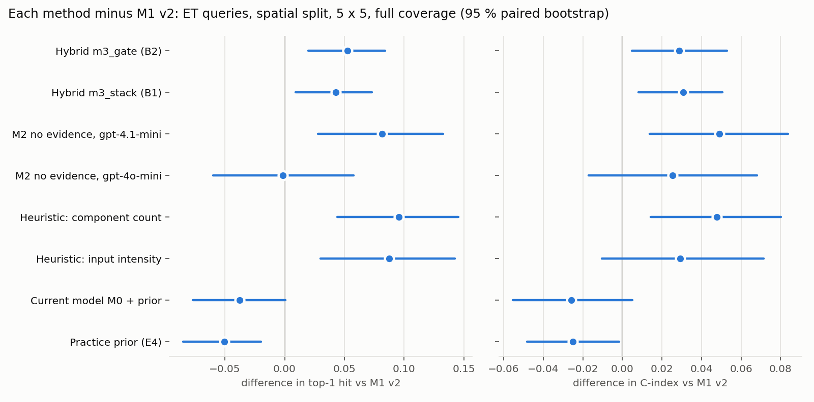
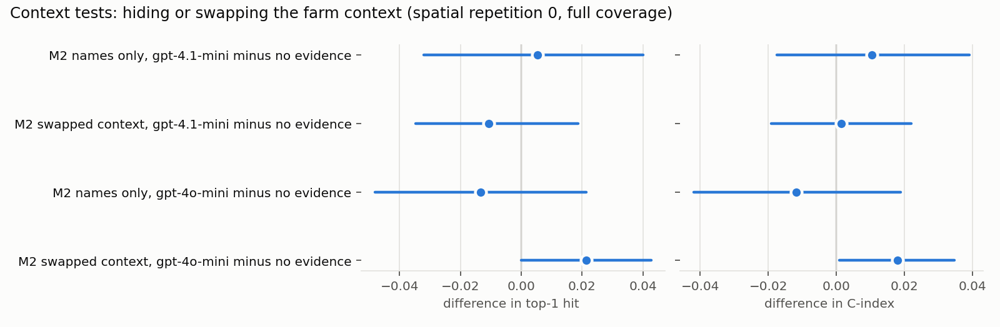

# Methodology comparison (E7, 2026-11-12)

Written for the Methodology page (E8) and the manuscript. Every number below is read from the evaluation runs of the E4 harness (`model/harness/runs/`); `metrics.json` beside this file holds them in machine-readable form.

## 1. The protocol in plain words

Each test question is one published field trial in Ethiopia: one site, one objective (for example crop yield or soil loss), one crop and the practices the trial compared. A method sees the site's context, the objective, the crop and the list of practices, and must put the practice that did best first. The trial's own results are hidden from every method through every channel: training rows, retrieved passages, the knowledge graph and the prompts of the language model. There are 375 such questions from 106 study groups.

Two ways of hiding trials are used. **Spatial**: whole regions are held out, five times over (5 folds x 5 repetitions), which tests advice for a place the methods have not seen. **Study**: whole studies are held out the same way. Scores: **top-1 hit** (the best practice was put first; chance is 39.6 %), **C-index** (the share of practice pairs put in the right order; 0.5 is chance) and NDCG@3. A method that cannot answer a question is filled by the practice prior ("full coverage"), so every method is scored on every question. Differences between methods are paired query by query and carry 95 % bootstrap intervals; a difference counts only when its interval excludes zero.

Methods: simple baselines (the average effect of each practice; the nearest studies), the current serving model M0, Methodology 1 (M1 v2: an evidence model trained on 19,753 effect rows with calibrated 80 % intervals), Methodology 2 (a language model ranking from the same evidence, or from no evidence at all), two heuristics without any model, and two hybrids in which the language model may change the order while every number still comes from M1 v2.

## 2. Headline (ET queries, full coverage, mean of 5 x 5)

*Spatial split*

| method | top-1 hit | C-index | NDCG@3 | 80 % coverage | 80 % width |
|---|---:|---:|---:|---:|---:|
| Practice prior (E4) | 46.9% | 0.578 | 0.798 | 12.9% | 0.132 |
| Current model M0 + prior | 48.2% | 0.578 | 0.797 | 47.9% | 0.648 |
| M1 v2, evidence model (E5) | 51.9% | 0.603 | 0.830 | 81.7% | 1.301 |
| M1 v2 E5.1 (post-hoc, pre-registered 12 Nov) | 53.5% | 0.614 | 0.843 | 82.8% | 1.373 |
| Heuristic: component count | 61.5% | 0.651 | 0.881 | - | - |
| Heuristic: input intensity | 60.7% | 0.633 | 0.886 | - | - |
| M2 no evidence, gpt-4o-mini | 51.8% | 0.629 | 0.825 | 8.6% | 0.094 |
| M2 no evidence, gpt-4.1-mini | 60.1% | 0.653 | 0.888 | 16.3% | 0.119 |
| Hybrid m3_stack (B1) | 56.2% | 0.634 | 0.864 | 81.7% | 1.301 |
| Hybrid m3_gate (B2) | 57.2% | 0.632 | 0.865 | 81.7% | 1.301 |

*Study split*

| method | top-1 hit | C-index | NDCG@3 | 80 % coverage | 80 % width |
|---|---:|---:|---:|---:|---:|
| Practice prior (E4) | 48.0% | 0.575 | 0.809 | 13.0% | 0.137 |
| Current model M0 + prior | 50.5% | 0.596 | 0.812 | 48.6% | 0.648 |
| M1 v2, evidence model (E5) | 54.6% | 0.618 | 0.844 | 80.0% | 1.268 |
| M1 v2 E5.1 (post-hoc, pre-registered 12 Nov) | 54.9% | 0.618 | 0.858 | 81.3% | 1.360 |
| Heuristic: component count | 61.4% | 0.646 | 0.883 | - | - |
| Heuristic: input intensity | 60.6% | 0.630 | 0.886 | - | - |
| M2 no evidence, gpt-4o-mini | 53.4% | 0.634 | 0.837 | 9.8% | 0.107 |
| M2 no evidence, gpt-4.1-mini | 59.1% | 0.643 | 0.887 | 16.9% | 0.111 |
| Hybrid m3_stack (B1) | 57.7% | 0.635 | 0.876 | 80.0% | 1.268 |
| Hybrid m3_gate (B2) | 56.9% | 0.622 | 0.866 | 80.0% | 1.268 |

*Common subset, spatial split: 67 queries every method answered without the prior fill in every repetition (small, because the nearest-studies baseline and M0 often cannot answer; read with care)*

| method | top-1 hit | C-index | NDCG@3 |
|---|---:|---:|---:|
| Practice prior (E4) | 63.3% | 0.653 | 0.949 |
| Nearest studies (E4) | 68.7% | 0.724 | 0.918 |
| Current model M0 | 66.6% | 0.701 | 0.961 |
| M1 v2, evidence model (E5) | 72.8% | 0.723 | 0.959 |
| M1 v2 E5.1 (post-hoc, pre-registered 12 Nov) | 70.7% | 0.719 | 0.967 |
| Heuristic: component count | 67.2% | 0.682 | 0.977 |
| Heuristic: input intensity | 59.4% | 0.614 | 0.979 |
| M2 no evidence, gpt-4o-mini | 53.7% | 0.672 | 0.875 |
| M2 no evidence, gpt-4.1-mini | 59.7% | 0.627 | 0.967 |
| Hybrid m3_stack (B1) | 65.7% | 0.691 | 0.966 |
| Hybrid m3_gate (B2) | 67.2% | 0.668 | 0.965 |

*Common subset, study split: 67 queries every method answered without the prior fill in every repetition (small, because the nearest-studies baseline and M0 often cannot answer; read with care)*

| method | top-1 hit | C-index | NDCG@3 |
|---|---:|---:|---:|
| Practice prior (E4) | 64.5% | 0.674 | 0.957 |
| Nearest studies (E4) | 71.0% | 0.744 | 0.927 |
| Current model M0 | 68.1% | 0.720 | 0.959 |
| M1 v2, evidence model (E5) | 75.2% | 0.760 | 0.968 |
| M1 v2 E5.1 (post-hoc, pre-registered 12 Nov) | 60.3% | 0.658 | 0.971 |
| Heuristic: component count | 66.6% | 0.685 | 0.979 |
| Heuristic: input intensity | 58.8% | 0.618 | 0.981 |
| M2 no evidence, gpt-4o-mini | 53.7% | 0.682 | 0.890 |
| M2 no evidence, gpt-4.1-mini | 59.7% | 0.637 | 0.970 |
| Hybrid m3_stack (B1) | 65.4% | 0.697 | 0.977 |
| Hybrid m3_gate (B2) | 66.6% | 0.671 | 0.972 |

Language-model rows: the no-evidence variants do not depend on the folds, so one answer per question serves all 25 folds (identical rows checked). The evidence variants of M2 ran on spatial repetition 0 only (owner's minimal design, E6); they are in section 4.

## 3. The paired differences that matter (spatial split, 5 x 5, full coverage)

| comparison | n | top-1 hit | C-index | NDCG@3 |
|---|---:|---:|---:|---:|
| Hybrid m3_gate (B2) minus M1 v2 | 375 | +0.053 [+0.020, +0.084] * | +0.029 [+0.005, +0.053] * | +0.035 [+0.018, +0.054] * |
| Hybrid m3_stack (B1) minus M1 v2 | 375 | +0.043 [+0.009, +0.073] * | +0.031 [+0.008, +0.051] * | +0.034 [+0.021, +0.047] * |
| M2 no evidence, gpt-4.1-mini minus M1 v2 | 375 | +0.082 [+0.028, +0.133] * | +0.049 [+0.014, +0.084] * | +0.058 [+0.034, +0.080] * |
| M2 no evidence, gpt-4o-mini minus M1 v2 | 375 | -0.002 [-0.060, +0.058] | +0.025 [-0.017, +0.068] | -0.006 [-0.029, +0.015] |
| Heuristic: component count minus M1 v2 | 375 | +0.095 [+0.044, +0.146] * | +0.048 [+0.014, +0.080] * | +0.051 [+0.027, +0.075] * |
| Heuristic: input intensity minus M1 v2 | 375 | +0.087 [+0.030, +0.142] * | +0.029 [-0.010, +0.071] | +0.056 [+0.031, +0.081] * |
| M1 v2 E5.1 (post-hoc, pre-registered 12 Nov) minus M1 v2 | 375 | +0.015 [-0.007, +0.037] | +0.011 [-0.008, +0.031] | +0.013 [+0.005, +0.020] * |
| Current model M0 + prior minus M1 v2 | 375 | -0.038 [-0.077, +0.001] | -0.026 [-0.055, +0.005] | -0.033 [-0.053, -0.017] * |
| Practice prior (E4) minus M1 v2 | 375 | -0.051 [-0.085, -0.020] * | -0.025 [-0.048, -0.002] * | -0.032 [-0.047, -0.019] * |
| m3_gate vs m3_stack | 375 | +0.010 [-0.021, +0.043] | -0.002 [-0.023, +0.020] | +0.001 [-0.011, +0.015] |
| m2_zero 4.1-mini vs component_count | 375 | -0.014 [-0.059, +0.037] | +0.001 [-0.040, +0.043] | +0.007 [-0.016, +0.031] |
| m3_gate vs m2_zero 4.1-mini | 375 | -0.029 [-0.069, +0.009] | -0.020 [-0.046, +0.004] | -0.022 [-0.037, -0.007] * |
| m3_gate vs component_count | 375 | -0.043 [-0.090, +0.003] | -0.019 [-0.058, +0.016] | -0.015 [-0.037, +0.008] |
| m3_gate vs m0_current+prior | 375 | +0.091 [+0.039, +0.140] * | +0.054 [+0.016, +0.094] * | +0.069 [+0.044, +0.095] * |
| m3_stack vs m2_zero 4.1-mini | 375 | -0.039 [-0.075, -0.005] * | -0.018 [-0.043, +0.006] | -0.024 [-0.040, -0.007] * |
| m3_stack vs m0_current+prior | 375 | +0.081 [+0.036, +0.126] * | +0.057 [+0.024, +0.090] * | +0.067 [+0.048, +0.089] * |

*Study split, minus M1 v2:*

| comparison | n | top-1 hit | C-index |
|---|---:|---:|---:|
| Hybrid m3_gate (B2) | 375 | +0.023 [-0.008, +0.052] | +0.004 [-0.020, +0.028] |
| Hybrid m3_stack (B1) | 375 | +0.031 [-0.001, +0.062] | +0.017 [-0.005, +0.039] |
| M2 no evidence, gpt-4.1-mini | 375 | +0.045 [-0.007, +0.097] | +0.026 [-0.010, +0.063] |
| Heuristic: component count | 375 | +0.068 [+0.021, +0.118] * | +0.028 [-0.005, +0.064] |

## 4. Spatial repetition 0: every method including the M2 evidence variants

| method | top-1 hit | C-index | NDCG@3 |
|---|---:|---:|---:|
| Practice prior (E4) | 44.5% | 0.570 | 0.791 |
| Current model M0 + prior | 48.8% | 0.591 | 0.803 |
| M1 v2, evidence model (E5) | 49.1% | 0.591 | 0.816 |
| Heuristic: component count | 60.8% | 0.643 | 0.879 |
| Heuristic: input intensity | 60.3% | 0.629 | 0.886 |
| M2 no evidence, gpt-4o-mini | 51.7% | 0.628 | 0.823 |
| M2 cards, gpt-4o-mini | 47.7% | 0.566 | 0.801 |
| M2 cards + passages, gpt-4o-mini | 48.0% | 0.563 | 0.802 |
| M2 full evidence, gpt-4o-mini | 49.1% | 0.580 | 0.802 |
| M2 no evidence, gpt-4.1-mini | 59.5% | 0.646 | 0.888 |
| M2 full evidence, gpt-4.1-mini | 52.3% | 0.594 | 0.828 |
| M2 names only, gpt-4o-mini | 50.4% | 0.617 | 0.823 |
| M2 names only, gpt-4.1-mini | 60.0% | 0.656 | 0.882 |
| M2 swapped context, gpt-4o-mini | 53.9% | 0.646 | 0.826 |
| M2 swapped context, gpt-4.1-mini | 58.4% | 0.647 | 0.887 |
| Hybrid m3_stack (B1) | 57.3% | 0.640 | 0.854 |
| Hybrid m3_gate (B2) | 56.8% | 0.638 | 0.859 |

## 5. Validity of the language-model result (Part A)

E6 found that `gpt-4.1-mini` given no evidence ranked better than every evidence-based method. Three explanations predict that score: real location-aware knowledge, a generic ordering of practices (including the design of trials, where combined treatments are usually built to win), or recall of the published studies. The tests below were fixed before they ran.

**A1, fair reference.** Against M1 v2's five-repetition mean (not repetition 0 only), the no-evidence `gpt-4.1-mini` still leads: top-1 +0.082 [+0.028, +0.133] *, C-index +0.049 [+0.014, +0.084] * (spatial). On repetition 0 alone (E6) the top-1 gap was +0.104.

**A2 and A3, does the model use the farm context?** Spatial repetition 0, full coverage, 375 queries.

| model | variant | top-1 hit | C-index | top-1 minus no-evidence | C-index minus no-evidence | Kendall tau vs no-evidence (mean) | same top practice |
|---|---|---:|---:|---:|---:|---:|---:|
| gpt-4.1-mini | no evidence (own context) | 59.5% | 0.646 | | | | |
| gpt-4.1-mini | names only (no context, no crop) | 60.0% | 0.656 | +0.005 | +0.010 | 0.87 (n = 375) | 91% |
| gpt-4.1-mini | most different context | 58.4% | 0.647 | -0.011 | +0.001 | 0.90 (n = 374) | 93% |
| gpt-4o-mini | no evidence (own context) | 51.7% | 0.628 | | | | |
| gpt-4o-mini | names only (no context, no crop) | 50.4% | 0.617 | -0.013 | -0.012 | 0.84 (n = 374) | 93% |
| gpt-4o-mini | most different context | 53.9% | 0.646 | +0.021 | +0.018 | 0.92 (n = 374) | 94% |

**A4, heuristics without a language model.** Putting the practice with the most components first (ties by the practice prior) beats M1 v2 by +0.095 [+0.044, +0.146] * top-1 and +0.048 [+0.014, +0.080] * C-index (spatial, 5 x 5); ordering by input level beats it by +0.087 [+0.030, +0.142] * top-1. The no-evidence `gpt-4.1-mini` minus component count: top-1 -0.014 [-0.059, +0.037], C-index +0.001 [-0.040, +0.043]: the two cannot be told apart.

**A5, recall probes** (`gpt-4.1-mini`, 80 queries, one per study group, stratified by objective group and source). Identification: the model named the right study (first author and year within one) for 0% of them [0%, 0%]; it claimed to know the study for 1.2%. Title lift: adding the study's title and DOI changed top-1 by +0.000 [-0.067, +0.067] on the 75 queries that had a title or DOI (+0.000 on all 80).

**A6, fresh test set** (`fresh_2024plus`, Ethiopian trials published after June 2024): **pending**. The loader (`pipelines/evidence/load_fresh.py`), the query set and a one-fold harness split `fresh` are in place; with at least 30 queries, A1 and the hybrids run on it with `--query-set fresh_2024plus --split fresh`.

## 6. The hybrids (Part B)

Both use M1 v2 for every number, interval and citation; the language model (the cached no-evidence `gpt-4.1-mini` ranking) only changes the order. Their choices are made inside each training fold on M1 v2's inner folds.

- **m3_stack** chose, in the 50 outer fits: llm_w2 33, llm_w1 15, e5 2 (`e5` = M1 v2 unchanged; `llm_w1`/`llm_w2` = rank averaging with the language model at weight 1 or 2).
- **m3_gate** chose the density threshold 5 in 40 fits, 3 in 6 fits, 2 in 4 fits; the language-model order was used for 38.8% of the test questions.
- m3_gate minus M1 v2 (spatial): top-1 +0.053 [+0.020, +0.084] *, C-index +0.029 [+0.005, +0.053] *.
- m3_stack minus M1 v2 (spatial): top-1 +0.043 [+0.009, +0.073] *, C-index +0.031 [+0.008, +0.051] *.

## 7. Calibration (80 % intervals, held-out effects, 5 x 5)

| method | spatial | study |
|---|---:|---:|
| M1 v2, evidence model (E5) | 81.7% | 80.0% |
| M1 v2 E5.1 (post-hoc, pre-registered 12 Nov) | 82.8% | 81.3% |
| Hybrid m3_stack (B1) | 81.7% | 80.0% |
| Hybrid m3_gate (B2) | 81.7% | 80.0% |
| Current model M0 + prior | 47.9% | 48.6% |
| Practice prior (E4) | 12.9% | 13.0% |

The hybrids carry M1 v2's intervals unchanged, so their coverage equals M1 v2's on the same folds. The heuristics and the language model produce no intervals of their own (their full-coverage rows show the prior fill's intervals only).

## 8. Cost and latency

| method | model | USD per question | median latency | p95 latency |
|---|---|---:|---:|---:|
| M2 no evidence | gpt-4o-mini | 0.00020 | 2.7 s | 5.9 s |
| M2 no evidence | gpt-4.1-mini | 0.00056 | 1.7 s | 3.8 s |
| M2 full evidence | gpt-4o-mini | 0.00051 | 3.1 s | 7.8 s |
| M2 full evidence | gpt-4.1-mini | 0.00135 | 2.1 s | 4.3 s |
| M2 names only | gpt-4.1-mini | 0.00051 | 1.7 s | 3.6 s |
| M2 swapped context | gpt-4.1-mini | 0.00057 | 1.7 s | 4.0 s |
| M1 v2, heuristics | none | 0 (local, no external call) | not measured | |

`m3_gate` in production calls `gpt-4.1-mini` only for thin-evidence requests (the language-model order was used for 38.8% of the test questions), once per (rendered context, objective, crop, practice list), cached, with an 8 s timeout and the M1 v2 order as fallback. E7 spent 0.58 USD of its 20 USD cap.

## 9. The decision (Part C, pre-registered branches)

**Branch 2 applied. Production ranking: Hybrid m3_gate (B2).**

- Hiding the farm context and crop changed top-1 and C-index by at most 0.02.
- Giving each query the most different farm context changed top-1 and C-index by at most 0.02 and left the rankings nearly unchanged (mean Kendall tau 0.90 > 0.8).
- The LLM is a generic prior; m3_gate beats M1 v2 on the spatial split, so it enters only on thin-evidence queries.

What this means, in plain words. The language model's order is the same whatever the farm (it did not change when the farm context was hidden or replaced), so the gate adds a general ordering of practices where the field evidence is thin, not location-specific advice. The gain over M1 v2 holds on the spatial split, the split the rule uses; on the study split it is top-1 +0.023 [-0.008, +0.052], C-index +0.004 [-0.020, +0.028]. The component-count heuristic, which needs no language model, scores at least as well as the gate (gate minus heuristic: top-1 -0.043 [-0.090, +0.003], C-index -0.019 [-0.058, +0.016]); a gate with that heuristic was not pre-registered and was not run.

Branch 1 (recall dominates) is read first: identification above 25 % or a title lift above +0.10 with an interval excluding zero. Branch 2 (context not used): hiding or swapping the context moves top-1 and C-index by at most 0.02 (the swap also needs a mean Kendall tau above 0.8). Branch 3 otherwise. How the brief's open points were read (which model, which coverage, what "beats" means) is fixed in `model/e7/decision.py`, written before the results.

Calibration of the chosen design: 81.7% (spatial) and 80.0% (study) of held-out effects inside the 80 % intervals: within the 75 to 85 % target.

**Doctrine.** The decision lets the language model influence the order of practices; the owner must approve the amendment drafted in `docs/decisions/evidence_fusion_amendment_DRAFT.md` (not applied).

## 10. Limitations

- **The benchmark rewards trial design.** A heuristic that puts the practice with the most components first beats every evidence-based method, including M1 v2. Trials are usually designed so that the combined treatment wins, so the within-trial ranking task partly measures that structure rather than advice quality for a new farm. The scores of all methods should be read with that in mind.
- **No fresh test set yet.** `fresh_2024plus` is pending; it is the only clean test against recall.
- **M2 evidence variants on one repetition.** They ran on spatial repetition 0 only (owner's minimal design).
- **Deployable models only.** `gpt-4o-mini` and `gpt-4.1-mini` (owner, 12 Nov 2026); frontier models were not tested.
- **One country.** All 375 questions are Ethiopian; the 39 global questions were used only for `m2_graph` in E6.

